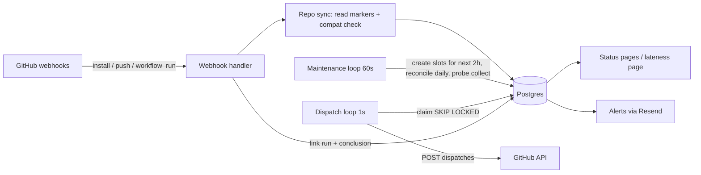
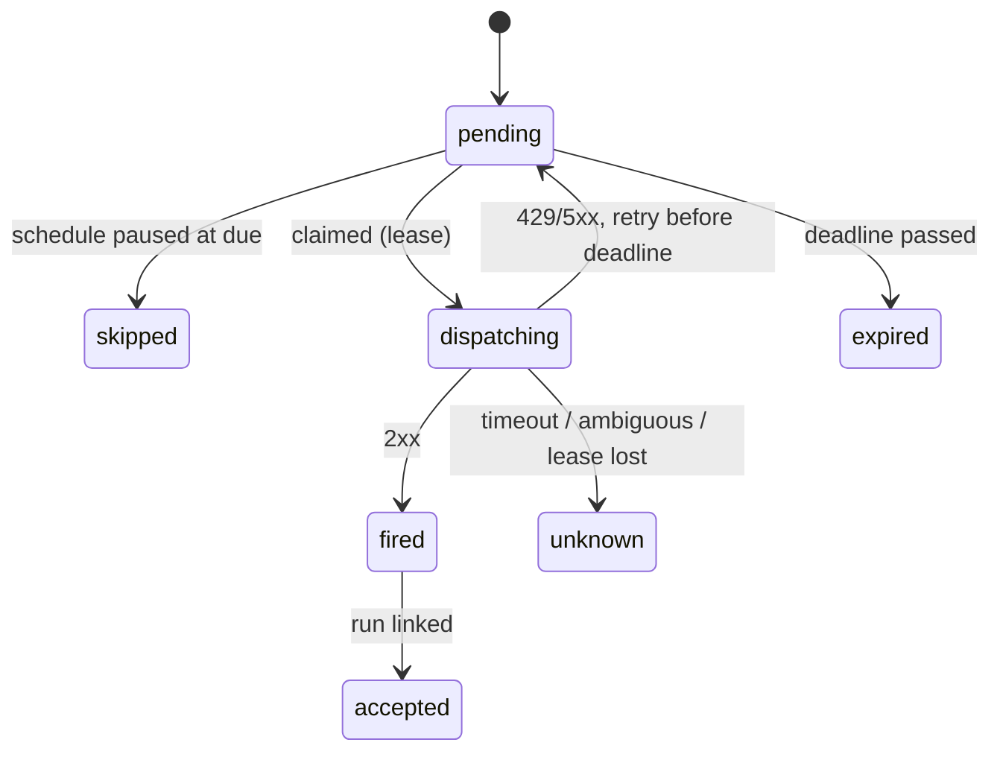

# feat: Build Ontime v1

## Summary

Build Ontime v1 as one Node 22 and TypeScript service. It does the following:

- receives GitHub App webhooks;
- reads the `# ontime:` markers from workflow files;
- stores each due slot in Postgres;
- fires `workflow_dispatch` within 30 s of each slot's due time;
- matches every slot to its run and records the result;
- shows a status page per workflow, sends Resend emails and enforces the Free and Pro limits.

Also in scope:
- a probe kit and a public lateness page;
- a deploy kit (written, not run).

Billing is a stub: you set an account's plan by hand. The web layer is Hono with server-rendered HTML.

---

## Problem Frame

GitHub's `schedule:` trigger is delaying or dropping runs (see origin: `PRD.md` §2). `workflow_dispatch` still works, so an outside clock that calls it, with no PAT and an exact record of every slot, solves the problem. The repo is greenfield: only `PRD.md` and `docs/plans/` exist.

---

## Requirements

PRD R-IDs carry over unchanged. Plan-only additions are marked P-n.

- R1–R4 (GitHub App and config), including timezones and multiple markers per workflow (PRD §6.1).
- R5–R10 (scheduler): unique slot key, `SKIP LOCKED` leases, first attempt ≤ 30 s after due, retry deadline (due + 5 min, or the next slot if sooner), the `unknown` and `expired` rules, plan intervals, rate limits and top-of-hour jitter.
- R11–R13 (visibility and alerts).
- R15 (plan limits: pause extra schedules, send an email). R14 (real billing) is deferred.
- R16–R17 (probes and the public lateness page).
- P1. The status page shows a user only the installations GitHub says they can access.
- P2. Every external action (creating repos, registering the App, DigitalOcean, DNS) is documented and never run by the code or plan.

---

## Scope Boundaries

- Not doing: Team tier, auto re-run, Slack and Discord alerts, a one-click PR, GHES/GitLab, or the D1(b) native-schedule fallback (PRD §4 and §14).
- No ORM. Plain SQL through `pg`, because `SKIP LOCKED` and `ON CONFLICT` are the core of the design, and Prisma would hide them.

### Deferred to Follow-Up Work

- Real checkout with Polar or Dodo (R14), once a provider is chosen and keys exist.
- Running the deploy, registering the App, creating the probe repos.

---

## Key Technical Decisions

- **One process, two loops.**
  - Hono HTTP server for webhooks, UI and the lateness page.
  - A 1 s dispatch loop.
  - A 60 s maintenance loop: create slots, reconcile, collect probe data.
  - Why: the PRD (§9) calls for a single process. Postgres is the only state, so a second process can be added later without changes.
- **Slots are created ahead of time.** The maintenance loop inserts slots for the next 2 hours with `ON CONFLICT DO NOTHING` on the slot key, `(installation_id, repo_id, workflow_id, due_at)`.
  - Two markers due at the same instant collapse into one slot.
  - The deadline is stored on the slot: the earlier of due + 5 min and the next due time of *any* marker on that workflow.
- **Claim, then call, with an `unknown` state for crashes.**
  - The dispatch loop claims due slots with `FOR UPDATE SKIP LOCKED` and sets `state=dispatching` with a lease, then calls GitHub.
  - If the lease expires while a slot is still `dispatching`, the process died mid-call. The slot becomes `unknown` and is never fired again (R8).
  - Retries happen only on 429, 5xx, or 403 with rate-limit headers. They set `next_attempt_at` and put the slot back to `pending`.
- **Slot states.** These are the meanings shown on the status page:
  - `fired`: GitHub returned 2xx.
  - `accepted`: the slot is linked to a GitHub run.
  - `unknown`: a timeout, an ambiguous response or a lost lease.
  - `expired`: the deadline passed without a successful attempt.
  - `skipped`: the schedule was paused when the slot came due.
  - `pending` and `dispatching` are internal.
- **Run matching.**
  - If the dispatch response includes a run ID (the newer response shape), store it, and the slot becomes `accepted` straight away.
  - Otherwise, a `workflow_run` webhook with `event=workflow_dispatch` is matched to the oldest `fired` slot on that workflow that has no run yet, within 10 min.
  - Known limit: a manual dispatch in that window can be matched to the wrong slot. The UI marks such matches as "matched by time".
- **Interval check.** The minimum gap between runs is measured across the next 50 occurrences of all markers combined. The workflow is flagged if the gap is below the plan floor: 15 min on Free, 5 min on Pro.
- **Reading markers.**
  - Markers are read from the raw workflow file text, because comments aren't in the parsed YAML.
  - The `yaml` package parses the file for the compatibility checks: `on.workflow_dispatch` present, required inputs, and use of `github.event.schedule` or `event_name == 'schedule'`.
- **Auth.**
  - `@octokit/app` for installation tokens and webhook verification.
  - The UI signs in through the App's user OAuth, checks `GET /user/installations`, and keeps the session in a signed, httpOnly cookie. No session table.
- **Billing stub.** `installations.plan` is `free` or `pro`. An `npm run plan:set` CLI changes it. The plan limits read that column only, so a real billing provider later only has to write it.
- **External calls are injected.** The GitHub client and the mailer are interfaces passed into the services. Tests use fakes, and the slot locking tests use a real Postgres.

---

## High-Level Technical Design



Slot lifecycle:



---

## Output Structure

```text
package.json  tsconfig.json  vitest.config.ts  .env.example
migrations/001_init.sql
src/
  config.ts  db.ts  main.ts
  markers.ts  compat.ts  slots.ts
  github.ts  sync.ts  webhooks.ts
  dispatcher.ts  maintenance.ts  runs.ts
  plans.ts  alerts.ts  mailer.ts
  web/{app.ts,auth.ts,views.ts}
  probe/{collector.ts,stats.ts}
scripts/{migrate.ts,set-plan.ts}
probe/workflows/{every-5.yml,hourly.yml}
deploy/{Caddyfile,ontime.service,README.md}
test/*.test.ts
```

---

## Implementation Units

### U1. Scaffold, config, schema

**Goal:** A project that builds, a typed env config, and the database schema.
**Requirements:** R2, R5.
**Dependencies:** none.
**Files:** `package.json`, `tsconfig.json`, `vitest.config.ts`, `.env.example`, `src/config.ts`, `src/db.ts`, `migrations/001_init.sql`, `scripts/migrate.ts`, `test/db.test.ts`.
**Approach:**
- Tables: `installations` (with `plan`), `repos`, `schedules` (one row per marker: `cron`, `tz`, `status`, `flag_reason`), `slots` (with the unique key), `alerts_sent` (dedupe), `probe_runs`.
- A tiny migration runner keeps a `schema_migrations` table and applies new files in order.
- Config validates env vars and fails fast when one is missing.
- The App private key comes from the environment or a file. The deploy kit encrypts it at rest.
**Test scenarios:**
- Migrating an empty test DB creates every table, and running it again is a no-op.
- Inserting a duplicate slot key fails.
- Missing `DATABASE_URL` throws a named config error.
**Verification:** `npm test` passes against a local Postgres.

### U2. Marker parser and compatibility check

**Goal:** Turn a workflow file into a list of schedules, or a list of flags.
**Requirements:** R3, PRD §5 step 3, D2.
**Dependencies:** U1.
**Files:** `src/markers.ts`, `src/compat.ts`, `test/markers.test.ts`, `test/compat.test.ts`.
**Approach:**
- Match `# ontime: "<5 fields>"` with an optional `tz=<IANA>`.
- Check the timezone with `Intl.supportedValuesOf('timeZone')` and the cron with `cron-parser`.
- `importFromSchedule` builds the suggested diff from `on.schedule`, carrying over every cron entry and its `timezone:`.
**Test scenarios:**
- One marker → one schedule with tz UTC. Two markers, one with `tz=Europe/Berlin` → two schedules.
- An invalid cron, an unknown tz, or a 6-field cron → a flag naming the line number.
- A file with no `workflow_dispatch` → flagged. A required `workflow_dispatch` input → flagged.
- `github.event.schedule` in a step, or `github.event_name == 'schedule'` in an `if:` → flagged.
- A native `schedule:` with two crons and a `timezone:` → the import diff contains both markers with that tz.
- A marker inside a YAML block string is ignored (only comment lines count).

### U3. Slot math

**Goal:** Pure functions for the next due times, each slot's deadline, the minimum interval, and jitter.
**Requirements:** R7, R9, R10.
**Dependencies:** U2.
**Files:** `src/slots.ts`, `test/slots.test.ts`.
**Approach:**
- Merge the occurrences of every marker on a workflow and remove duplicate instants.
- Deadline = the earlier of due + 5 min and the next due time.
- Jitter applies only to slots at :00. It's a fixed 0–15 s offset per workflow, taken from a hash of the workflow ID, which keeps the first attempt within 30 s.
**Test scenarios:**
- `*/5` → deadline = next due (5 min). `0 * * * *` → deadline = due + 5 min.
- Two markers due at the same instant → one slot.
- `30 2 * * *` in Europe/Berlin on the spring-forward day → no slot. On the fall-back day → exactly one slot.
- A min interval of 4 minutes is flagged on both plans, and 10 minutes is flagged on Free only.
- Jitter is stable for the same workflow, 0 when the slot isn't at :00, and ≤ 15 s.

### U4. GitHub client, webhooks, repo sync

**Goal:** Verified webhooks keep `installations`, `repos` and `schedules` in step with GitHub.
**Requirements:** R1–R4.
**Dependencies:** U1, U2.
**Files:** `src/github.ts`, `src/webhooks.ts`, `src/sync.ts`, `test/webhooks.test.ts`, `test/sync.test.ts`.
**Approach:**
- `github.ts` wraps `@octokit/app` behind a small interface with four calls: list workflows, get a file at a ref, dispatch, and get a run.
- Webhook handling:
  - `installation.created` → sync every repo.
  - `installation.deleted` or `installation.suspend` → pause everything.
  - `installation_repositories` → add or pause repos.
  - `push` to the default branch that touches `.github/workflows/` → re-sync that repo.
- Sync replaces a workflow's schedules in a single transaction.
- A schedule whose marker or file disappeared is paused, and its pending slots become `skipped`.
- The daily reconcile pass runs the same sync for every active repo.
**Test scenarios:**
- A bad or missing `X-Hub-Signature-256` → 401, and nothing is written.
- An install with two repos, one of them with a marker → 1 active schedule.
- A push that removes the marker → the schedule is paused, and its future pending slots are `skipped`.
- A push to a non-default branch → no sync.
- An uninstall → all schedules paused, and the dispatch loop claims none of their slots (integration test with U5).

### U5. Dispatcher and maintenance loop

**Goal:** Fire every due slot exactly once, on time, with correct retry, expiry and `unknown` handling.
**Requirements:** R5–R8, R10.
**Dependencies:** U3, U4.
**Execution note:** Write the Postgres concurrency tests first. This is where duplicate-fire bugs would live.
**Files:** `src/dispatcher.ts`, `src/maintenance.ts`, `test/dispatcher.test.ts`.
**Approach:**
- Claim query: `pending`, `fire_at <= now`, `next_attempt_at <= now`, `LIMIT n`, `FOR UPDATE SKIP LOCKED`. It sets `dispatching` with a 60 s lease, then the call runs outside the transaction with a 10 s timeout.
- A token bucket per installation, in memory, caps the request rate.
- Results:
  - 2xx → `fired`, storing the run ID if present.
  - 429 or 5xx → back to `pending` with backoff, if still before the deadline.
  - 4xx other than throttling → `unknown`, recording the response.
  - A timeout → `unknown`.
- The maintenance loop:
  - creates slots for the next 2 hours;
  - marks `pending` slots past their deadline as `expired`;
  - marks `dispatching` slots with an expired lease as `unknown`;
  - runs the daily reconcile.
**Test scenarios:**
- Two dispatchers running at once over 50 due slots → exactly 50 dispatch calls, no duplicates (real Postgres).
- A 503 then a 204 → one slot, two attempts, `fired`.
- A 503 until the deadline → `expired` and never fired afterwards.
- The fake client hangs → `unknown` after the timeout, and no second call.
- A slot left `dispatching` with an expired lease (simulated crash) → maintenance marks it `unknown`, and no second call.
- A 422 (workflow has no dispatch trigger) → `unknown`, with the response stored.
- Creating slots twice → no duplicate rows.

### U6. Run matching

**Goal:** Link each fired slot to its run and record the conclusion.
**Requirements:** R12.
**Dependencies:** U5.
**Files:** `src/runs.ts`, `test/runs.test.ts`.
**Approach:**
- Match by run ID first. Otherwise, a `workflow_run` webhook (event `workflow_dispatch`) links to the oldest `fired` slot with no run on that workflow, created within 10 min, and the link is marked `matched_by=time`.
- The `completed` action stores the conclusion.
**Test scenarios:**
- A run ID from the dispatch response, then `workflow_run.completed` → `accepted` with conclusion `success`.
- A bare 204, then `workflow_run.requested` → linked by time.
- A `workflow_run` with event `push` → ignored.
- A `workflow_run` with no slot waiting to be matched → ignored, with no error.

### U7. Plans, limits, billing stub

**Goal:** Enforce the Free and Pro limits and pause extra schedules (R15).
**Requirements:** R9, R11, R15, D3, D4.
**Dependencies:** U4.
**Files:** `src/plans.ts`, `scripts/set-plan.ts`, `test/plans.test.ts`.
**Approach:**
- Free: 1 repo, 3 schedules, 15-minute floor, last 20 slots shown.
- Pro: 50 schedules, 5-minute floor, 90 days of history.
- After each sync, schedules in order of creation stay active up to the limit. The rest become `paused_limit`, and a limit email goes out once.
- `set-plan` updates the plan and re-applies the limits.
**Test scenarios:**
- A Free install with 5 marked schedules → 3 active, 2 `paused_limit`, one email.
- Upgrading to Pro → all 5 active.
- A second repo on Free → its schedules are `paused_limit`.
- A Free schedule every 10 min → flagged (U3), not paused.

### U8. Alerts

**Goal:** Email paid accounts about `unknown` or `expired` slots and failed runs, plus the limit email.
**Requirements:** R13, R15.
**Dependencies:** U5, U6, U7.
**Files:** `src/mailer.ts`, `src/alerts.ts`, `test/alerts.test.ts`.
**Approach:**
- `mailer.ts` calls Resend's HTTP API with `fetch`, which needs no SDK.
- The recipient is the email of the installing user, or an email set in the UI.
- `alerts_sent` dedupes on slot ID plus alert type.
- Free accounts get only the limit email.
**Test scenarios:**
- A Pro slot `expired` → one email, and running again sends none.
- A Free slot `expired` → no email.
- `conclusion=failure` on Pro → one email.
- Resend returns 500 → logged, the alert is not marked sent, and it retries on the next pass.

### U9. Web UI

**Goal:** Sign in with GitHub, see your installations, workflows, slot history, compatibility flags and suggested diffs.
**Requirements:** R11, P1, PRD §5 steps 2 and 5.
**Dependencies:** U4–U7.
**Files:** `src/web/app.ts`, `src/web/auth.ts`, `src/web/views.ts`, `src/main.ts`, `test/web.test.ts`.
**Approach:**
- Routes:
  - `/` landing page;
  - `/login` and `/callback` for OAuth;
  - `/i/:installationId` workflow list with flags and diffs;
  - `/i/:id/w/:workflowId` slot table;
  - `/webhooks`;
  - `/lateness`;
  - `/healthz`.
- Pages are server-rendered HTML strings with escaping, and no client JavaScript.
- Every page counts slots in each state.
**Test scenarios:**
- No session → redirect to `/login`.
- A user whose `/user/installations` doesn't include `:id` → 404 (no cross-tenant view).
- The slot table shows `unknown` and `expired` slots and the full count.
- A repo name like `<script>` is rendered escaped.
- Free sees 20 rows. Pro sees 90 days.

### U10. Probe kit and lateness page

**Goal:** Measure GitHub's own schedule lateness and publish it (R16, R17).
**Requirements:** R16, R17.
**Dependencies:** U1, U4, U9.
**Files:** `probe/workflows/every-5.yml`, `probe/workflows/hourly.yml`, `probe/README.md`, `src/probe/collector.ts`, `src/probe/stats.ts`, `test/probe.test.ts`.
**Approach:**
- The probe workflows use only the native `schedule:` and a no-op step.
- The collector lists recent runs for the repos in `PROBE_REPOS` with a read token, finds the slot each run belongs to, and stores the delay.
- Stats over 7 days: p50, p95, and the share of expected slots with no run, with the denominator shown.
**Test scenarios:**
- Runs delayed 1, 2, 3, 10 and 40 min → correct p50 and p95.
- 12 expected slots with 9 runs → 25% missing, denominator 12.
- A run that started more than one interval late is counted against its own slot, not the next one.
- No data yet → the page says "collecting" instead of showing 0%.

### U11. Deploy kit

**Goal:** Everything needed to run it on a DigitalOcean droplet, written but not executed (P2).
**Requirements:** PRD §10, P2.
**Dependencies:** U9.
**Files:** `deploy/Caddyfile`, `deploy/ontime.service`, `deploy/README.md`, `.env.example`.
**Approach:**
- The README covers: GitHub App settings (permissions, events, callback and webhook URLs), the order of the `doctl` steps from PRD §10, Postgres setup, migrating, and setting a plan.
**Test expectation:** none (configuration and docs only).

---

## Risks & Dependencies

| Risk | Mitigation |
|---|---|
| The dispatch response shape (whether it returns a run ID) differs from what we expect | Handle a 200 with a run ID and a bare 204 alike, and fall back to matching by time (U6). |
| Matching by time links a manual dispatch to the wrong slot | Marked `matched_by=time` in the UI. Documented. |
| `cron-parser`'s timezone and DST behaviour doesn't match the spec | U3's DST tests pin the expected behaviour before anything relies on it. |
| Process crash mid-dispatch | Lease expiry → `unknown`, never fired again (U5 test). |
| Tests need Postgres | A local `postgresql@17` exists, and tests use a separate `ontime_test` DB. |

---

## Open Questions (deferred to implementation)

- The exact current `@octokit/*` and `cron-parser` APIs: check the installed versions when wiring them up.
- The dispatch request parameter for asking GitHub to return run details: check GitHub's REST docs when building U5.
