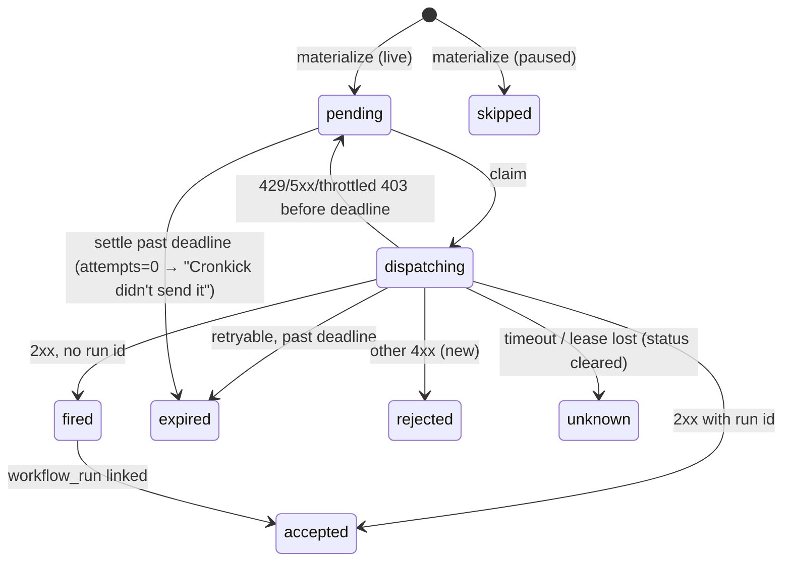
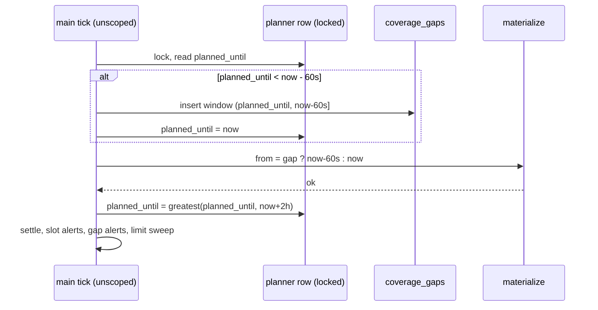

# fix: Trust pass: honest states, honest claims, trust surfaces

## Summary

Make every number, status and claim Cronkick shows provably true, then add the few trust surfaces a skeptical buyer checks. The dashboard gets an honest state model: waiting, overdue, refused, unconfirmed, outage windows, and on-time scored from the successful send. The site drops claims the data can't back. Permissions, operator and exit path become visible. No redesign.

Revision 2 folds in both plan reviews (`../research/round12-plan-review-{gpt,opus}.md`). The biggest change is in U2: outages are recorded as one **coverage window**, not reconstructed slot by slot. Both reviews showed that per-slot reconstruction claims eligibility history the system doesn't have.

---

## Problem Frame

Two independent reviews (see origin) found that Cronkick reads as vibe-coded because of claims the product can't support and a dashboard that can say green when it isn't. The look is not the problem.

A team lead deciding whether to grant `actions: write` finds:
- a 95% headline from one new private repo;
- mockups whose numbers don't add up;
- permission copy that understates the grant;
- legal text describing a checkout that doesn't exist.

The dashboard has its own problems:
- it counts past-due unsent slots as harmless;
- it records GitHub refusals as "Unconfirmed";
- it scores on-time from the claim rather than the send;
- it tells a valid nightly schedule it is "waiting for push";
- it leaves no trace of a Cronkick outage longer than the 2 h planning horizon;
- for shorter outages, it blames GitHub.

---

## Requirements

**Dashboard truth**
- R1. Due slots partition exactly: due = on time + late + waiting + overdue + unconfirmed + refused + gave up.
  - **Waiting:** due but not yet sent, at most 60 s past `due_at`.
  - **Overdue:** unsent and more than 60 s past `due_at`.
  - The verdict is "on time" only when due = on time.
- R2. A non-retryable GitHub refusal is recorded and shown as its own state ("Refused"), separate from "Unconfirmed". Existing rows are not reclassified.
- R3. On time / late is measured from the successful send (`fired_at`). Unconfirmed and refused rows show when Cronkick *tried*, not a send time.
- R4. "Unconfirmed" has its own pattern and label and is not drawn or toned as a red miss anywhere.
- R5. A workflow whose marker is valid and whose next due time is beyond the 2 h horizon is shown as configured. Its next due time is computed from the cron, using the same eligibility rule as the planner.
- R6. An installation with zero selected repositories is pointed at repository selection.
- R7. When Cronkick's planner stops for longer than its horizon, the outage is recorded as a coverage window (start, end). It shows on the overview and on workflow history, blocks an "on time" verdict while it overlaps the 24 h window, and sends one email per affected Pro installation. Slots that expire because Cronkick never attempted them say so; they are not blamed on GitHub.
- R8. Overview totals, the account switcher and the account list use one population: every slot of the installation in the window. Recent misses survive their workflow becoming Needs a fix, Paused, removed or deselected.
- R9. History can be paged beyond the first 500 rows within the plan's retention window.

**Claims**
- R10. No public page claims more than the code and data prove. Specifically, none of:
  - "on the minute", "never late", "never twice" / "never sent twice", "every run on time", "under a second";
  - "Most teams", "run charts";
  - an unconditional limit-email promise;
  - a turnaround or payment arrangement the owner hasn't confirmed.
- R11. Pro is described as "Request Pro · manual activation" everywhere, including Terms, Privacy, Refunds and docs.
- R12. The homepage has no live miss-rate badge. `/lateness` and the dashboard benchmark card disclose their sample:
  - configured vs contributing probe repos, and per-repo windows;
  - last successful complete collection, and any current error.

  A failed or partial fetch never counts as a GitHub miss. Sub-minute medians show seconds.
- R13. Landing-page product visuals use current status names and navigation, internally consistent numbers, and an "Example" label, or they are removed.

**Trust surfaces**
- R14. `/docs/security` states three things:
  - what Contents: read and Actions: write allow;
  - the scheduling API surface Cronkick calls, listed separately from sign-in and probe calls;
  - what Cronkick itself doesn't do. It doesn't read secret values or push commits, and the workflows it triggers can still use their secrets and permissions.

  Install CTAs link to the page in one line.
- R15. An operator block says who runs Cronkick, where it runs, and what happens if it shuts down. It is linked from the footer and the security docs.
- R16. Docs explain what happens if Cronkick goes down and give a copyable procedure to return to GitHub's native `schedule:`.
- R17. `/.well-known/security.txt` exists; the site has an Open Graph image. `/healthz/dispatch` fails when the planner stops advancing or a dispatch lease is stranded.

**Navigation and access**
- R18. Docs, pricing and security are reachable from a phone. The public 404 offers Home and Docs. Public pages reflect real sign-in state.
- R19. Evidence works without a mouse and fits a phone:
  - history rows expand with keyboard and touch, through a real button with `aria-expanded`;
  - job results are readable on phones;
  - the marker's Copy control is visible;
  - `/lateness` tables show that they scroll;
  - the overview labels its strip window apart from its 24 h counts.
- R20. The limit email goes out once an alert address is saved, and the UI says where to set it. Plan-limit docs describe the real pause order.

---

## Scope Boundaries

- No visual redesign, new domain, logo or brand change (see origin).
- No billing integration, payment link, or Marketplace work. Those are owner actions in the origin doc.
- No run charts, Team tier, Slack/Discord, reruns, SOC 2 or trust center.
- No job-level runner timing via `workflow_job`; "Runner started" is relabelled "GitHub started the run".
- No Cronkick-vs-GitHub row on `/lateness` this round.
- No decorative-motion purge. Only pulses that imply unproven health go.
- No open-sourcing.
- No reclassification of historical `unknown` rows (it would invent certainty and re-alert).
- No per-slot reconstruction of outage history (eligibility during the outage is unknown).

### Deferred to Follow-Up Work

- Status page link in the footer once the owner sets up `status.cronkick.xyz`.
- The "Request Pro" mailto swapped for a hosted payment link once the owner has one.
- A Cronkick comparison row on `/lateness` with matched expected-slot denominators.
- Paging the probe collector past its 1,000-run cap. Today a collector outage longer than about 3.5 days can leave an unexamined interval; that limit is documented on `/lateness`.
- Making the `MAIL_FROM` default in `src/config.ts` (`alerts@cronkick.xyz`) match `.env.example` (`alerts@mail.cronkick.xyz`). The owner confirms the intended sender with the DNS work.

---

## Context & Research

Phase 1 research came from the round-12 reviews and plan reviews, which cite file:line for everything below.

### Relevant Code and Patterns

- **Slot lifecycle:**
  - `src/dispatcher.ts`: `claim`, `record`, `fire`;
  - `src/maintenance.ts`: `materialize` (the unscoped and per-installation paths share it), `refreshSlots`, `settle`;
  - `src/slots.ts`: `planSlots`, `merged`, `cron-parser`.
- **Main tick order** (`src/main.ts`): materialize → settle → alerts, then reconcile.
- **Migrations:**
  - Numbered plain SQL files run by `migrate()` in `src/db.ts`, which skips files by name, so an applied file is never re-run. Project convention; no Prisma.
  - The slot state constraint is the auto-named `slots_state_check` (`migrations/001_init.sql`).
- **Dashboard data** (`web/lib/data.ts`): `toTick`, `SlotView`, `COUNTS_SQL`, `healthOf`, `overview`, `recentSlots`, `workflowHistory`, `activity`, `accountHealth`.
- **Presentation:**
  - `web/components/ui.tsx`: `SLOT_LABEL`, `SLOT_TONE`, `SLOT_HELP`, `SlotPill`;
  - `web/components/live-strip.tsx`, `web/components/slot-strip.tsx` (`Record<Tick, …>` maps and `StripLegend`);
  - `web/app/dashboard/page.tsx` (`WORD`/`DOT` keyed by `Health` via an `as keyof` cast, which the type checker won't catch);
  - `web/app/dashboard/[installationId]/page.tsx` (`missed()`, row dot, verdict copy, legend, first-run gate);
  - `web/components/history-table.tsx` (`Steps` hides `responseNote` without `responseStatus`).
- **Alerts** (`src/alerts.ts`): `sendSlotAlerts` (keys `kind:slot id`, 100 per pass) and `sendLimitNotice`. Both need worker `Deps`; the Next server action has no mailer.
- **Health:** `/healthz/dispatch` in `src/web/app.ts` checks only overdue pending rows.
- **Probe:** `src/probe/collector.ts` (10-page cap; a page failure breaks with a partial result), `src/probe/stats.ts`, `web/app/lateness/page.tsx`.
- **Tests:**
  - Vitest against real Postgres (`test/helpers.ts`; `freshDb()` applies all migrations). `test/db.test.ts` hard-codes the table count and migration list.
  - `test/dashboard.test.ts` fixtures set only `first_attempt_at`, never `fired_at`.
  - Schedule `created_at` defaults to DB wall time while tests use a fake clock.
- **`web/AGENTS.md`:** this Next.js differs from training data. Read `node_modules/next/dist/docs/` before using cookies in server components or metadata APIs.

---

## Key Technical Decisions

- **One clock for lateness.** All thresholds are measured from `due_at`: on time ≤ 30 s after `due_at` (send succeeded), waiting ≤ 60 s, overdue > 60 s and unsent. Jitter (≤ 15 s) sits inside both.
- **Overdue and waiting are derived at read time** from `pending`/`dispatching` rows with `due_at <= now`. No schema change, no drift.
- **Overdue copy distinguishes cause.** `attempts = 0` reads "Cronkick hasn't sent N yet". `attempts > 0` reads "Retrying N: GitHub returned errors".
- **"Refused" is a new stored state `rejected`,** written only by `record()` for non-retryable 4xx. There is no historical backfill. Timeouts and lost leases clear `response_status`, so a stale 429 never sits next to "Unconfirmed".
- **Outages are coverage windows, not slots.**
  - A single-row planner watermark records how far ahead slots have been planned (`planned_until = tick time + 2 h`).
  - A new gap step runs **first** in the unscoped main tick, never in `refreshSlots`. Under a row lock, it records a window when the watermark has fallen behind `now`. The window is `(planned_until, now − 60 s]`, and the watermark is set to `now`.
  - That tick then materializes from `now − 60 s`, so the restart minute is covered and the intervals are contiguous. The watermark advances to `now + 2 h` after `materialize` succeeds.
  - A NULL watermark (first deploy) records nothing.
  - **Alerts:** one email per Pro installation with live schedules per window (key `gap:<window>:<installation>`).
- **Never-attempted expiries are attributed neutrally.** When `settle()` expires a row with `attempts = 0`, it sets the note "Cronkick didn't send it before its deadline". This covers short outages and the pre-planned first 2 h of a long one. Generic "Gave up" help stops blaming GitHub. History shows `response_note` whether or not there is an HTTP status.
- **SlotView carries a display state:** the stored state, or `waiting` / `overdue`. Pill, label, help, tooltip and tick derive from it. `fire_at`, `attempts`, `fired_at` and one `now` are threaded through every mapper.
- **One population for account-level numbers.** Overview totals, `accountHealth` and the account list share one SQL fragment over all installation slots in the window. The account switcher also reports needs-fix, so it can't say "on time" while the overview says "needs a fix".
- **First run shows only when no slot has come due yet.** Any due slot means the incident view applies.
- **Next due uses the planner's eligibility predicate** (active schedule, unflagged and present workflow, active repo, installation not suspended or removed) and the shared next-due helper in `src/slots.ts`.
- **The limit email is sent by a worker sweep.** A maintenance step finds installations with paused schedules, an alert email and `limit_email_sent_at IS NULL`, and calls `sendLimitNotice`. The settings action stays a plain write.
- **Probe coverage is per configured repo.**
  - A health row records last attempt, last *complete* success (all pages fetched without error) and last error.
  - Expected slots count only up to last complete success minus grace.
  - Repos come from the configured list, so zero-observation repos are disclosed.
  - The 1,000-run cap is a documented limit (deferred).
- **Pause order is documented, not changed.** `applyLimits` keeps schedules repo-first by repo age, then schedule age.
- **Older history uses a `before` cursor on `due_at`,** bounded by `historyDays`.
- **The Open Graph image is a static PNG** exported from `brand/`, not an image-response route.
- **Each migration is a separate file:** 004 (states and planner) and 005 (probe health). Applied files are never edited.

---

## High-Level Technical Design

Slot states after this change. Waiting and overdue are derived display states; the rest are stored.

Main tick, after this change (directional):

Display mapping (directional):

| Stored state | Condition | Display / tick | Label |
|---|---|---|---|
| fired / accepted | `fired_at - due_at <= 30 s` | ontime | Sent / Started |
| fired / accepted | later | late | Sent / Started |
| pending / dispatching | `due_at <= now`, ≤ 60 s past | waiting | Sending |
| pending / dispatching | > 60 s past `due_at` | overdue | Overdue |
| unknown | — | unconfirmed (striped) | Unconfirmed |
| rejected | — | missed | Refused |
| expired | — | missed | Gave up |
| pending (future) / skipped | — | idle | Due / Skipped |

---

## Implementation Units

### U1. Refused state, planner watermark, coverage windows (schema + dispatcher)

**Goal:** Schema and dispatcher support for `rejected`, the watermark and coverage windows.

**Requirements:** R2, R3, R7

**Dependencies:** None

**Files:**
- Create: `migrations/004_refused_and_coverage.sql`
- Modify: `src/dispatcher.ts`, `src/maintenance.ts` (lease-lost path), `src/alerts.ts`
- Test: `test/dispatcher.test.ts`, `test/db.test.ts`

**Approach:**
- The migration replaces `slots_state_check` with a version that includes `rejected`. It adds a single-row planner table (`planned_until`, NULL initially) and a coverage-window table (id, started_at, ended_at, detected_at). No data backfill.
- `record()`: retryable statuses keep their branch first, and other 4xx write `rejected`. Timeouts write `unknown` with `response_status = NULL`. Lease-lost in `settle()` clears it too.
- `sendSlotAlerts` includes `rejected` with its own message: "GitHub refused the trigger: <note>. Check the workflow and the App's access; Cronkick won't retry". The alert key is `rejected:<id>`. The expired message uses `response_note` when present.
- Update `test/db.test.ts` for the new tables and migration list.

**Patterns to follow:** Guarded updates in `record()` (`AND state = 'dispatching'`); existing migration files.

**Test scenarios:**
- Happy path: a 422 leaves the slot `rejected` with status and note.
- Edge case: a 403 with `retry-after` and a 429 still retry (`pending`).
- Edge case: 429 → retry → timeout ends `unknown` with `response_status` NULL.
- Edge case: a lease lost mid-call ends `unknown` with status NULL.
- Integration: a Pro install with an email gets one alert for a `rejected` slot; a second pass sends none.
- Integration: `migrate()` on a fresh DB creates the new tables; the migration list matches.

**Verification:** Dispatcher and DB tests pass.

---

### U2. Coverage windows, neutral expiry, planner health

**Goal:** A Cronkick outage leaves an honest, visible trace, and short outages stop blaming GitHub.

**Requirements:** R7, R17 (health half)

**Dependencies:** U1

**Files:**
- Modify: `src/maintenance.ts` (new gap step; `settle` note), `src/main.ts` (tick order), `src/alerts.ts` (gap email), `src/web/app.ts` (`/healthz/dispatch`), `web/lib/data.ts` (windows overlapping a range), `web/app/dashboard/[installationId]/page.tsx`, `web/app/dashboard/[installationId]/workflows/[workflowId]/page.tsx`, `web/components/history-table.tsx`, `web/components/ui.tsx` (`SLOT_HELP.expired`)
- Test: `test/maintenance.test.ts` (new), `test/web.test.ts`, `test/dashboard.test.ts`

**Approach:**
- The gap step runs at the start of the unscoped tick, in one transaction holding the planner row lock (KTD and sequence diagram). `refreshSlots` and per-installation `materialize` never read or write the watermark.
- The main tick materializes from `now − 60 s` on the recovery tick, and from `now` otherwise. The watermark advances after `materialize` succeeds; a failure leaves it so the next tick retries.
- `settle()` sets the neutral note on never-attempted expiries. `SLOT_HELP.expired` becomes "Not sent before its deadline, so Cronkick skipped it rather than run it late. The note says why."
- `Steps` in the history table shows `responseNote` without requiring `responseStatus`.
- Gap email: for each window and each Pro installation with an alert email and live schedules, send one email, claimed through `alerts_sent` with key `gap:<window id>:<installation id>`. The text gives the start and end and links the dashboard.
- Dashboard: a window overlapping the 24 h range shows a banner on the overview: "Cronkick was not running from X to Y. Schedules due then weren't sent." The verdict can't be on time. A window overlapping the shown history range shows the same banner on workflow history.
- `/healthz/dispatch` fails when `planned_until < now + 2 h − 5 min` or any `dispatching` row has `lease_until < now − 1 min`, alongside the existing overdue check.

**Test scenarios:**
- Happy path: watermark 10:30, recovery tick at 15:30 → one window (10:30, 15:29], watermark ends at 17:30, and a slot due 15:29:30 is created `pending` and claimable.
- Edge case: NULL watermark → no window; watermark set after the tick.
- Edge case: watermark only 30 s behind → no window.
- Edge case: recovery exactly at a due minute (15:00:00 with an hourly schedule) → the 15:00 slot exists and is pending.
- Integration: `refreshSlots` for installation A before the first unscoped tick leaves the watermark untouched, and the following tick still records the window.
- Integration: two concurrent unscoped ticks (two pool clients) record exactly one window.
- Integration: a `materialize` failure leaves the watermark unchanged.
- Happy path: a pending row with `attempts = 0` expired by `settle` gets the neutral note; one with `attempts > 0` keeps its GitHub note.
- Integration: one window with two Pro installations and one Free installation → two emails; a second pass sends none; a failed send is retried next pass.
- Integration: overview verdict with a window inside 24 h is not `on_time`, and the banner data is present.
- Health: a stale watermark → 503; a stranded dispatching lease → 503; healthy → 200.

**Verification:** Tests pass. Locally, stopping the worker for longer than the horizon and restarting shows the banner.

---

### U3. Honest dashboard state model

**Goal:** Ticks, pills, counts, health and verdicts tell the truth on every surface.

**Requirements:** R1, R3, R4, R8

**Dependencies:** U1

**Files:**
- Modify: `web/lib/data.ts`, `web/lib/live.ts` (if `fmtDelay` changes), `web/components/ui.tsx`, `web/components/live-strip.tsx`, `web/components/slot-strip.tsx`, `web/components/activity.tsx`, `web/components/history-table.tsx`, `web/components/account-switcher.tsx`, `web/app/dashboard/page.tsx`, `web/app/dashboard/[installationId]/page.tsx`, `web/app/dashboard/[installationId]/workflows/[workflowId]/page.tsx`, `web/app/globals.css`
- Test: `test/dashboard.test.ts`

**Approach:**
- `SlotView` gains `display` (stored state, `waiting` or `overdue`), `sendDelayMs` (from `fired_at`) and `triedDelayMs` (from `first_attempt_at`, for unconfirmed and refused rows). `toTick` derives from `display`.
- `recentSlots` and `activity` include due unsent rows, so overdue shows in strips and the feed. `workflowHistory` selects the extra columns. All mappers take one `now`.
- `COUNTS_SQL` produces the R1 partition, with on time and late from `fired_at`. A single account-population fragment feeds overview totals, `accountHealth` and the account list. Per-workflow rows keep per-workflow counts.
- `Health` and `Verdict` gain `behind`, `in_progress` and `unconfirmed`. Precedence: needs fix > coverage gap (U2) > behind > missed > unconfirmed > in progress > late > on time > no runs. Every `Record<Health|Tick|Verdict, …>` map, including `web/app/dashboard/page.tsx`, gets the new keys. Remove the `as keyof` cast so the compiler catches misses.
- Overview fixes:
  - the `missed()` helper and the row dot;
  - the copy "started within 30 s" → "sent within 30 s";
  - "measured to Cronkick's request" → "measured to GitHub accepting the request";
  - the legend;
  - remove the verdict `animate-ping`.
- First run shows only when no slot of the installation has come due.
- Labels:
  - `rejected` "Refused": red, with its own icon;
  - `unknown` stays "Unconfirmed", toned zinc/amber with a striped tick;
  - `waiting` "Sending";
  - `overdue` "Overdue";
  - "Runner started" → "GitHub started the run".
- Update test fixtures to set `fired_at` independently of `first_attempt_at`.

**Patterns to follow:** The `COUNTS_SQL` / `counts()` pairing; `SlotPill` (icon + label, never colour alone).

**Test scenarios:**
- Covers R1: two on time plus one pending at +5 min (`attempts = 0`) → verdict `behind`, partition `3 = 2 + 0 + 0 + 1 + 0 + 0 + 0`.
- Edge case: a pending slot at +20 s → `waiting`, verdict `in_progress`, partition holds.
- Edge case: a `dispatching` slot at +20 s → `waiting`; at +90 s → `overdue`.
- Edge case: pending at +3 min with `attempts = 1` (retry backoff) → overdue, with the retrying copy flag.
- Covers R3: claimed at +0 s, `fired_at` at +4 min → late; the history row shows a send delay of 4 min.
- Edge case: an `unknown` row shows its tried delay and no send delay.
- Covers R4: one `unknown`, the rest on time → `unconfirmed`, not `missed`.
- Edge case: one `rejected` → `missed`, refused count 1.
- Covers R8: a gave-up slot on a workflow that is then flagged, and one on a repo that is then deselected → both still in overview counts. `accountHealth` agrees with overview, and the switcher reports needs-fix.
- Integration: `recentSlots` and `activity` return an overdue row with display `overdue`.
- Integration: an install with one active schedule, no sends, and one overdue pending slot → not first-run; verdict `behind`.

**Verification:** Dashboard tests pass. Typecheck passes with no casts on health maps. With seeded local data, no surface says on time while anything is waiting, overdue or in a coverage window.

---

### U4. Configured-but-sparse schedules and first run

**Goal:** Nightly and weekly markers are recognized immediately, with a real next due time. Zero repos leads to repo selection.

**Requirements:** R5, R6

**Dependencies:** U3 (shares `data.ts` and the overview page)

**Files:**
- Modify: `src/slots.ts`, `web/lib/data.ts`, `web/components/first-run.tsx`, `web/app/dashboard/[installationId]/page.tsx`, `web/app/dashboard/[installationId]/workflows/[workflowId]/page.tsx`
- Test: `test/slots.test.ts`, `test/dashboard.test.ts`

**Approach:**
- Add a next-due helper in `src/slots.ts` that takes a list of schedules (cron + tz).
- `overview` and `workflowHistory` compute next due from schedules passing the planner's eligibility predicate. Workflow detail selects the repo-active and suspended fields it lacks today.
- First run treats a workflow as found when it has eligible schedules, not when it has slots. Copy: "Configured. First run <local> (<UTC>)."
- With zero active repos, the headline and CTA point at Choose repositories; "Watching 0 repositories" goes.

**Patterns to follow:** `merged` / `minIntervalMinutes` in `src/slots.ts`.

**Test scenarios:**
- Happy path: `0 3 * * *` UTC at 14:00 → next due tomorrow at 03:00.
- Edge case: `Europe/Berlin` across a DST change → the correct instant.
- Edge case: two schedules → the earlier one.
- Integration: a daily-only install 13 h before due → active workflow with `nextDue`, configured first-run state.
- Edge case: a suspended installation or an inactive repo → no next due.
- Edge case: zero active repos → the choose-repositories state.

**Verification:** Tests pass. A seeded daily-only install renders the configured state.

---

### U5. Lateness and probe honesty

**Goal:** The hero miss-rate goes. `/lateness` discloses its sample and freshness, and fetch failures can't read as GitHub misses.

**Requirements:** R12

**Dependencies:** None

**Files:**
- Create: `migrations/005_probe_health.sql`
- Modify: `src/probe/collector.ts`, `src/probe/stats.ts` (if needed), `web/app/lateness/page.tsx`, `web/app/page.tsx`, `web/app/dashboard/[installationId]/page.tsx` (benchmark card)
- Test: `test/probe.test.ts`, `test/db.test.ts`

**Approach:**
- Add a per-repo health row: last attempt, last complete success, last error and its time. A fetch counts as complete only if every page succeeded and pagination ended before the cap. A capped fetch stores its runs, records "incomplete: hit the 1,000-run cap" and doesn't advance last complete success.
- `probeReport` builds its inventory from the configured repos and the health rows. Per repo, expected slots run from its first stored due time to last complete success minus grace. It exposes configured count, contributing count, per-repo window, freshness and current error.
- `/lateness` gets a plain "Sample" block: "1 of 1 probe repos reporting · private · since Nov 10 14:05 UTC · last complete check 3 min ago". It also shows any error and the 1,000-run cap limit.
- Remove the hero "LIVE · GitHub missed N%" pill. "Repositories" and "Last 7 days" become the real window.
- Benchmark card: seconds under one minute, the same sample disclosure, and "public" dropped.

**Test scenarios:**
- Happy path: a full fetch advances last complete success.
- Error path: page 1 succeeds and page 2 returns 502 → page-1 runs are stored, the error is recorded, last complete success is unchanged, and expected excludes time after it.
- Edge case: a fetch that hits the page cap → recorded as incomplete, success not advanced.
- Edge case: a configured repo that never succeeded appears in the inventory with zero contribution and its error.
- Edge case: a healthy repo plus a never-fetched repo → configured 2, contributing 1.
- Edge case: a 40 s median renders "40 s".

**Verification:** Probe and DB tests pass. Locally, `/lateness` shows the sample block.

---

### U6. Claims match behaviour (copy pass)

**Goal:** Every public sentence is true today.

**Requirements:** R10, R11, R20 (docs half)

**Dependencies:** U2, U3, U5 (copy references their behaviour)

**Files:**
- Modify: `web/app/page.tsx`, `web/app/layout.tsx` (description), `web/app/support/page.tsx`, `web/app/terms/page.tsx`, `web/app/privacy/page.tsx`, `web/app/refunds/page.tsx`, `web/app/docs/{timing,plans,statuses,quickstart,migrate}/page.tsx`, `web/lib/docs.ts`, `docs/launch.md`
- Test expectation: none -- copy only; the review pass checks each claim against code.

**Approach:**
- **Timing:** "on the minute" → "within seconds of the scheduled time"; the target is "first trigger attempt within 30 s".
- **Delivery behaviour:** "If GitHub is throttling or erroring, Cronkick retries until the slot's deadline, then skips it rather than run it late. If it can't tell whether GitHub got the request, it doesn't resend." Drop "Never late, never twice" and "If it runs on GitHub Actions today, it runs on time".
- **Compatibility checks:** "flags anything that behaves differently" → "flags the common breakages", followed by the list.
- **Remove:** the "Most teams" badge, "run charts" and the "See the trend" bento. Keep "$90/year" only if the owner has confirmed it; otherwise show monthly only and flag it.
- **Pro:** "Request Pro · manual activation" everywhere. Terms, Privacy and Refunds say there is no card processor yet and drop the Dodo-as-live text. Don't invent turnaround or invoicing terms.
- **Limit email:** "if you've added an alert address in Settings".
- **Docs:**
  - Statuses: add Sending, Overdue and Refused.
  - Timing: the on-time boundary is the successful send. Describe coverage windows and their limits (first deploy, current planner horizon).
  - Plans: the repo-first pause order.
  - Quick start: drop the "about two minutes" claim next to a daily example.
- **`docs/launch.md`:** "your jobs never leave GitHub" (not "your code"), and no sub-second claims.

**Verification:** The banned phrases from R10 don't appear in `web/` or `docs/launch.md`. Each behavioural sentence maps to code, and the review pass checks this directly, not only with grep.

---

### U7. Product visuals match the product

**Goal:** Landing mockups show today's product with consistent example numbers, or they are removed.

**Requirements:** R13

**Dependencies:** U3 (status vocabulary)

**Files:**
- Modify: `web/components/product.tsx`, `web/components/timeline-compare.tsx`, `web/components/marker-card.tsx`, `web/components/slot-strip.tsx`, `web/app/page.tsx`
- Test expectation: none -- static presentation.

**Approach:**
- Delete vignettes by default: run table, lifecycle and compat, unless one carries something the page doesn't say elsewhere.
- Build one small fixture for the dashboard shot only, and compute its totals and percentages from it.
- Use current labels from `ui.tsx` (no server deps) and current nav names. Each remaining vignette gets an "Example" tag.
- Rename frequent jobs labelled "nightly". Fix the TimelineCompare sub-line.

**Verification:** Every landing number is derived from the fixture or removed. None of the old status names ("Ran", "Expired", "Unknown") remain.

---

### U8. Permission truth and operator identity

**Goal:** The install decision has a true permission explanation and a named operator.

**Requirements:** R14, R15

**Dependencies:** None

**Files:**
- Modify: `web/app/docs/security/page.tsx`, `web/app/support/page.tsx`, `web/app/page.tsx` (FAQ and one line by the install CTAs), `web/components/site.tsx` (footer), `web/lib/docs.ts` (nav, if needed)
- Create: `web/app/about/page.tsx` (operator block)
- Test expectation: none -- content; checked against `src/github.ts`, `web/app/callback/route.ts` and `src/probe/collector.ts` in review.

**Approach:**
- **What the grant allows.** Take this from GitHub's permission documentation, not from memory:
  - Contents: read → read any file in the selected repos.
  - Actions: write → trigger, cancel, re-run and delete runs and logs, approve runs, and change OIDC subject settings.
- **Scheduling API surface:** list installations, list installation repos, list workflows, get file contents, create workflow dispatch.
- **Other calls:** sign-in (OAuth user and installations lookup); probe run reads against Cronkick's own repos.
- **What Cronkick doesn't do:** read secret values, push commits, or edit workflow files. The workflows it triggers run with their own secrets and permissions, as they would on GitHub's schedule.
- **Also on the page:** where data lives, what is stored, and how to revoke.
- **FAQ and support copy:** "reads only the workflow files" → "reads workflow files; the permission allows reading any file in the repos you select".
- **Operator block (`/about`):**
  - owner name, country and GitHub profile;
  - hosting provider and region;
  - support email;
  - what happens on shutdown (from Terms).

  Use only facts already in Terms and Privacy, and mark any blank for the owner with a visible TODO in the PR description, not on the page.
- **Install CTAs:** add "What Cronkick can access →".

**Verification:** The scheduling list matches `src/github.ts`. No page says "reads only".

---

### U9. Navigation, recovery and sign-in state

**Goal:** Phone users can reach docs, pricing and security; the 404 recovers; public pages know you're signed in.

**Requirements:** R18

**Dependencies:** None

**Files:**
- Modify: `web/components/site.tsx`, `web/app/not-found.tsx`, `web/app/docs/layout.tsx`, `web/app/support/page.tsx`, `web/app/privacy/page.tsx`, `web/app/terms/page.tsx`, `web/app/refunds/page.tsx`
- Test expectation: none -- layout and navigation.

**Approach:**
- Header: a disclosure menu below `sm` with Docs, Pricing (`/#pricing`), Security and Sign in / Dashboard. Use native `
` or a tiny client toggle; no new dependency.
- 404: Home and Docs, plus Dashboard when signed in.
- Replace the hard-coded `signedIn={false}` with the session read used elsewhere. Check the Next docs on cookies in server components first.

**Verification:** At 390 px every top-level destination is two taps away, and signed-in users see Dashboard on public pages.

---

### U10. Keyboard and phone evidence

**Goal:** History and evidence work without a mouse and fit a phone.

**Requirements:** R19

**Dependencies:** U3

**Files:**
- Modify: `web/components/history-table.tsx`, `web/components/activity.tsx`, `web/components/marker-card.tsx`, `web/components/live-strip.tsx`, `web/app/lateness/page.tsx`, `web/app/dashboard/[installationId]/page.tsx` (strip window label), `web/app/globals.css`
- Test expectation: none -- interaction markup; verified by a keyboard walk-through in review.

**Approach:**
- Each expandable history row's toggle is a `<button aria-expanded aria-controls>`.
- Below `sm`, rows stack: due, pill, send delay, job result.
- The marker Copy button is always visible.
- `/lateness` tables get a scroll wrapper with a fade cue.
- Overview: label the strip as the last N scheduled times, separate from the 24 h counts.
- A strip tick click whose row is filtered out shows a tip instead of failing silently.

**Verification:** Tab reaches and toggles every row. At 390 px the job result shows without horizontal scroll.

---

### U11. History paging and limit-email sweep

**Goal:** Stored history is reachable, and the limit email goes out once an address exists.

**Requirements:** R9, R20

**Dependencies:** U3

**Files:**
- Modify: `web/lib/data.ts` (`workflowHistory` with `before`), `web/app/dashboard/[installationId]/workflows/[workflowId]/page.tsx`, `src/alerts.ts` (sweep), `src/main.ts` (call the sweep), `web/components/first-run.tsx` and the paused-schedule banner (link to Settings)
- Test: `test/dashboard.test.ts`, `test/plans.test.ts`

**Approach:**
- `workflowHistory` takes an optional `before` and returns `hasOlder`. The page renders "Load older" as a `?before=` link, bounded by `historyDays`.
- Worker sweep (see KTD). The settings action stays a plain write.
- Copy: "Add an alert email in Settings to hear about limits and misses."

**Test scenarios:**
- Happy path: 600 slots in the window → 500 rows with `hasOlder` true; then `before` = oldest → 100 rows with `hasOlder` false.
- Edge case: `before` past retention → empty, with `hasOlder` false.
- Error path: a malformed `before` is ignored.
- Integration: paused schedules and no email → the sweep sends nothing. An email set → one notice. A second sweep → none. Unpausing resets it.

**Verification:** Tests pass; "Load older" appears only when there is more.

---

### U12. Trust surfaces: exit path, security.txt, share image, live label

**Goal:** The small, permanent trust signals a buyer looks for.

**Requirements:** R16, R17 (static half)

**Dependencies:** U6, U8

**Files:**
- Create: `web/public/.well-known/security.txt`, `web/public/og.png` (exported from `brand/`)
- Modify: `web/app/docs/migrate/page.tsx`, `web/app/page.tsx` (FAQ), `web/app/layout.tsx` (openGraph/twitter metadata), `web/components/live-refresh.tsx`
- Test expectation: none -- static content and metadata.

**Approach:**
- **Migrate docs, "Go back to GitHub's scheduler":** copyable YAML that restores `schedule:` from the marker's cron, removes the marker, then uninstalls. Warn against keeping both, which causes double runs.
- **FAQ, "What if Cronkick goes down?":**
  - nothing is sent late;
  - unsent times show as gave up with a note, and a long outage shows as a window;
  - Pro gets an email;
  - there is no automatic fallback to GitHub's scheduler.
- **`security.txt`:** contact (the support address), an expiry one year out, and the canonical URL.
- **Open Graph image:** a static PNG with the wordmark and the one-line pitch.
- **Dashboard:** "Live" → "Live updates", and its ping goes.

**Verification:** `/.well-known/security.txt` serves, `<head>` has `og:image`, and the migrate page has the exit procedure.

---

## System-Wide Impact

- **State consumers:** `rejected` and the derived `waiting`/`overdue` must reach every typed map, as well as the state literals. Before closing U3, run the typechecker with the `as keyof` cast removed. Grep `'unknown'`, `'expired'`, `Tick`, `Health` and `Verdict` across `src/` and `web/`.
- **Rolling deploy:** an old server briefly renders `rejected` raw. This is harmless.
- **Public pages become dynamic** (U9). Acceptable at current traffic.
- **Historical on-time numbers shift** because the boundary moves to `fired_at`. This is expected, and the timing docs note it.
- **Tick order changes** (gap step first). `reconcileAll` still runs after.

---

## Risks & Dependencies

| Risk | Mitigation |
|---|---|
| A coverage window is recorded falsely (clock skew, slow tick) | 60 s slack; a window needs the watermark *behind now*, which a healthy tick sets 2 h ahead |
| Two servers race on the watermark | Row lock in one transaction; a concurrent-tick test |
| A gap email flood | One email per window per installation, deduped through `alerts_sent` |
| Next.js API differences | Read `node_modules/next/dist/docs/` per `web/AGENTS.md` |
| Operator facts are unknown | Use only facts in Terms/Privacy; blanks go to the owner |

---

## Open Questions

### Deferred to Implementation

- The exact striped pattern for `unconfirmed` within the palette (late is orange-300, and next is an amber outline).
- Whether "$90/year" stays: check the owner's intent in PRD and Terms. If it isn't confirmed, show monthly only.

---

## Sources & Research

- Origin: `docs/design/2026-11-11-trust-review.md`
- Reviews and critiques: `../research/round12-{gpt,opus}.md`, `../research/round12-{gpt,opus}-critique.md`
- Plan reviews: `../research/round12-plan-review-{gpt,opus}.md`
- Prior design reviews: `docs/design/2026-11-10-dashboard-review-{gpt,opus}.md`
