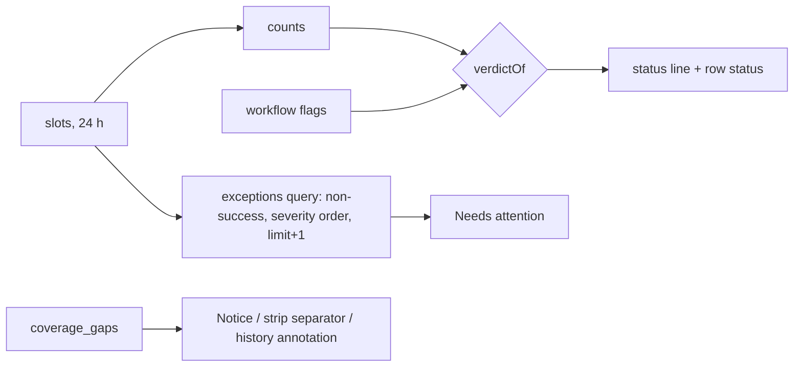

# feat: Dashboard UI/UX pass

## Summary

Redesign the signed-in dashboard so it reads like a calm, professional monitoring product.
- **Overview:** one status line, problems listed only when there are any, and schedule rows whose numbers match their strips.
- **Workflow page:** history in 50-row pages with day headers and outage annotations, a fix panel when one is needed, and a keyboard-usable strip.
- **Look:** marketing decoration removed from the app, one type scale, and a status palette in which amber means the brand only.

Landing page and docs are a later pass.

---

## Problem Frame

Round 12 made the numbers and words true. The look and the layout stayed the same, and the owner says the dashboard "still feels weird". Two independent reviews (GPT-6.1 Sol and Opus 5.5), each followed by a cross-critique of the other, agree on the causes:

1. **Repetition:** the same 24 h number appears 3–4 times, zeros included.
2. **A past outage outranks real problems.** Cronkick's own outage takes the headline and puts red dots on healthy workflows.
3. **Countdowns read as clock times.**
4. **A strip and its count can disagree:** the strip covers the last 48 runs and the count covers 24 h.
5. **The workflow page is 25,000 px tall,** and a run lost to an outage leaves a hole with no marker.
6. **The needs-fix page doesn't show the fix.**
7. **Accessibility gaps:**
   - the strip can't be reached by keyboard;
   - the switcher ignores arrow keys;
   - contrast is too low;
   - the phone targets are 28 px.
8. **Landing-page decoration in the app:** grid, glow, uppercase mono eyebrows, and amber used for six different meanings.

Evidence is in the origin folder, and screenshots are in `../research/round13-ui/before/`.

---

## Requirements

- **R1. Status line.** The overview headline is one status line, ranked needs fix > overdue > missed > unconfirmed > sending > late > on time > waiting for first run > nothing scheduled.
  - It describes what was observed: "1 overdue run", "No dispatch issues in the last 24 h".
  - A coverage gap never sets it.
- **R2. Coverage gaps are neutral and kept apart.**
  - On the page: a neutral zinc notice with date, interval and timezone, saying "runs due then may not have been sent".
  - In the strip: a labelled boundary marker. In the history: an annotation row.
  - A gap is never a workflow's status and never a fabricated run.
- **R3. Needs attention.** The overview lists exceptions from the last 24 h only when there are any. Exceptions are overdue, unconfirmed, refused, gave up, late, and failed job. They are queried in the 24 h window before any limit is applied, with "N more" when capped.
- **R4. Schedule rows.**
  - Counts and status words come from the same runs the row's strip shows.
  - The next run moves out of the strip and is written as an absolute time plus "in 4 min".
  - Each row carries one status word.
- **R5. Overview cleanup.** Delete the next-kick card, the Runs card, the "By outcome" disclosure, the benchmark card (replaced by a one-line link), the grid, the glow, the eyebrows and the sidebar badge. Success toasts stop; problem toasts remain.
- **R6. Workflow history.**
  - 50-row pages with Newer and Older controls at the top and bottom, and day headers.
  - Times labelled with their timezone.
  - Filters show counts over the retained window.
  - "—" where nothing was sent.
- **R7. Needs-fix panel.** It shows the flagged file and the fix first; earlier history stays below it.
  - Empty strip and filters are hidden only when there are no observations.
  - The first-run state confirms the configured schedule and its first due time.
- **R8. Visual system.**
  - Type scale 24/16/14/13/12; mono only for cron, times, durations and paths.
  - Readable text no dimmer than zinc-400.
  - Unconfirmed shown as hatched zinc. Amber only for brand, primary action and focus.
  - One global focus-visible style.
- **R9. Interaction.**
  - The workflow strip is a single tab stop with arrow-key selection and a text panel for the selected run. The overview strip is not interactive.
  - The account switcher is a disclosure of plain links.
  - The phone menu is separate from the logo link.
  - Phone tap targets are at least 44 px.
- **R10. Smaller fixes.**
  - Settings leads with the alert email.
  - The account list uses singular grammar ("1 schedule").
  - The demo seed's "paused: plan limit" account really is over its limit.

---

## Key Technical Decisions

- **Status line plus a small "Overview" title, not a bare title.** GPT argued for a fixed "Overview" title. Opus cited Linear's health word at the top of a project. We keep the verdict line because it answers the one question users come with. To meet GPT's concern, it is worded strictly as an observation and never claims overall health.
- **Coverage leaves the verdict and workflow health entirely.** Today `verdictOf` and `workflowHealth` rank `coverage_gap` above real outcomes (`web/lib/data.ts`). The overview returns `gaps` separately, and the UI shows them as a notice. The `coverage_gap` value is deleted from `Verdict`.
- **Exceptions come from their own query.** We filter the 24 h window for non-success outcomes, order by severity then time, and fetch limit + 1 so we know when there are more. Filtering the newest-8 activity feed instead could silently hide older problems (GPT's cross-critique, §3).
- **Strip counts are computed from the strip's own `SlotView[]`.** The overview strip shows 48 runs at every width, because ticks flex to fit, so desktop and phone counts match. The page-level summary keeps the 24 h totals and says so once.
- **History uses replacement pages, not "load more".** The page keeps the existing `before` cursor and adds an `after` cursor for Newer: rows due after the cursor, read in ascending order and then reversed. The browser's Back button keeps working because the cursor lives in the URL.
- **The strip is not drawn to a time scale,** so a gap is a thin labelled separator between two runs, not a band. In the table, gap annotation rows are placed by time between the rows of the current page.
- **No new dependencies.** We use native `<details>` for the switcher and status key, and a roving tabindex on the strip.

---

## High-Level Technical Design

Overview composition, desktop (directional):

```
Overview                                               Updates connected
● 1 overdue run                                        ← status line (R1)
393 of 398 sent on time · last 24 h · median +1.1 s · 1 job failed
[ⓘ Coverage gap · Nov 11, 07:19–07:59 IST · 40 min — runs due then may not have been sent]   (zinc, only if any)

Needs attention · 24 h                                 ← only if non-empty (R3)
▲ Overdue      Refresh cache · edge      13:15 IST   →
◌ Unconfirmed  Hourly report · analytics 10:30 IST   →
+ 2 more

Schedules · 4                          last 48 runs   Status key ⌄
Refresh cache · edge   every 5 min · UTC   ▮▮▮▮▮▮▮▯▮▮   1 overdue      13:30 IST · in 4 min  ›
Sync orders · shop     every 15 min · UTC  ▮▮▮┆▮▮▮▮▮▮   48 of 48 on time  13:30 IST · in 4 min  ›

GitHub's own schedule ran a median 2.6 min late this week · Benchmark →
```

Verdict data flow:



---

## Implementation Units

### U1. Data: verdict without coverage, exceptions, history pages

**Goal:** the data layer supplies everything the new UI needs, and coverage no longer leaks into any verdict.
**Requirements:** R1, R2, R3, R6
**Dependencies:** none
**Files:**
- Modify: `web/lib/data.ts`
- Test: `test/dashboard.test.ts`

**Approach:**
- Remove `coverage_gap` from `Verdict` and `WorkflowHealth`. `verdictOf` and `workflowHealth` use only `needsFix` and the counts. `gapsDue` and `gaps` stay as data (the overview and history keep returning `gaps`), and `accountHealth` stops passing gaps into the verdict.
- Add `exceptions(db, installationId, now, limit)`: slots due in (now − 24 h, now] that are overdue, unknown, rejected, expired, late, or have a failed conclusion. Order by severity (overdue, refused/gave up, unconfirmed, failed job, late), then newest first. Return `{ items: ActivityItem[], more: number }`.
- `workflowHistory`:
  - `MAX_ROWS` = 50;
  - accept an `after` cursor that is mutually exclusive with `before`, with the same bounds checks;
  - return `hasNewer` and `hasOlder`;
  - return `filterCounts` for each filter over the retained window (one query with `FILTER`);
  - return the page's `from` and `to` so gaps can be placed.
- `activity()` remains only for the live-arrival plumbing (strip growth, problem toasts). Its caller filters out successes.

**Patterns to follow:** `COUNTS_SQL` and `FILTERS` in `web/lib/data.ts`; the existing `before` cursor handling.

**Test scenarios:**
- A coverage gap in the last 24 h plus all on-time runs: verdict `on_time`, workflow health `on_time`, and `gaps` still returned. Rewrite the round-12 test "a coverage gap … blocks on time".
- Needs fix plus an overdue run: verdict `needs_fix`. Overdue plus unconfirmed: `behind`.
- `exceptions`: an overdue run 20 h ago behind 30 newer on-time runs is still returned. Ten exceptions with limit 6 give six items and `more` = 4. Another installation's exceptions are excluded. Only due rows count; a future pending one doesn't.
- History:
  - 120 rows give pages of 50, 50 and 20;
  - `after` from page 2 returns page 1 in descending order, and `hasNewer` is false on page 1;
  - a malformed or future `after` is ignored;
  - `filterCounts.late` equals the late rows in the window, not just on the page.
- Account health with a gap and on-time counts gives `on_time`.

**Verification:** `npm test` passes; no code path still returns `coverage_gap`.

### U2. Words and time formatting

**Goal:** times and counts read naturally, with no clock-like countdowns and no "All 1 schedule".
**Requirements:** R1, R4, R6, R10
**Dependencies:** U1
**Files:**
- Modify: `web/lib/live.ts`, `web/lib/format.ts`, `web/components/live.tsx`
- Test: `test/live.test.ts`

**Approach:**
- `countdown(ms)` becomes relative words: "now", "in 45 s", "in 4 min", "in 2 h 5 min", "in 3 days".
- Add a `tzAbbrev` helper for the viewer's local timezone, used as `13:30 IST`. A `<Time>` variant shows the absolute time with the abbreviation; `Countdown` renders the words.
- Rewrite the `VERDICT` strings:
  - `behind` → "1 overdue run" or "N overdue runs";
  - `missed` → "1 run not sent";
  - `unconfirmed` → "1 unconfirmed run";
  - `in_progress` → "Sending now";
  - `late` → "1 late run";
  - `on_time` → "No dispatch issues in the last 24 h";
  - `no_runs` → "Waiting for the first run";
  - `nothing_scheduled` → "Nothing scheduled yet";
  - `needs_fix` → "1 workflow needs a fix".

  Use singular and plural correctly.
- Add a `plural(n, word)` helper and use it everywhere a count meets a noun.

**Test scenarios:** the countdown at 0, 59 s, 4 min, 1 h 5 min and 26 h; each verdict string with n = 1 and n = 3; `tzAbbrev` returns a non-empty abbreviation for UTC and Asia/Kolkata.

**Verification:** the tests pass; no "All 1 schedule" anywhere.

### U3. Overview recomposition

**Goal:** the calm overview from the design above.
**Requirements:** R1–R5, R8
**Dependencies:** U1, U2
**Files:**
- Modify: `web/app/dashboard/[installationId]/page.tsx`, `web/components/activity.tsx`, `web/components/ui.tsx`
- Test: `test/dashboard.test.ts` covers the data; screenshot acceptance covers the composition.

**Approach:**
- **Header:** a small "Overview" title, then the status line with its dot, then one summary sentence (on time of due, median delay, failed jobs). No Stat cards, next-kick card, grid, glow or eyebrow.
- **`Notice`** in `ui.tsx`: a neutral zinc box with an info icon. It replaces the red `GapBanner` for gaps and shows the date, interval, duration and timezone.
- **`NeedsAttention`** in `activity.tsx`: renders `exceptions`. Each row has a pill, the workflow and repo, the absolute time, and a link to the workflow page. When there are more, a "+N more" line.
- **Schedule row:**
  - one status word, computed from the strip's own slots ("1 overdue", "48 of 48 on time", "Waiting for first run", "Needs a fix", "Paused · plan limit");
  - next due as `13:30 IST · in 4 min`;
  - no `opacity-60`, no "next" tick;
  - sorted with blockers first.
- **Status key:** a short inline key behind a `<details>` "Status key".
- **Benchmark:** one line with a link.
- **Toasts:** `DispatchToasts` shows problems only.

**Patterns to follow:** `Badge`/`SlotPill` and `tones` in `web/components/ui.tsx`.

**Test expectation:** none beyond U1's data tests. Composition is verified by screenshots (see Verification).

**Verification:**
- `dash-acme-1440` shows "1 overdue run" in red, Sync orders with a green dot, no zero counts, no countdown digits and no grid.
- `dash-umbrella-1440` shows "No dispatch issues in the last 24 h" with the zinc gap notice.
- `dash-acme-390` shows the first schedule row within the first 844 px.

### U4. Strip: palette, gap separator, keyboard selection

**Goal:** the strip reads clearly and can be used without a mouse.
**Requirements:** R2, R4, R8, R9
**Dependencies:** U1
**Files:**
- Modify: `web/components/live-strip.tsx`, `web/app/globals.css`

**Approach:**
- Remove the `next` tick.
- Unconfirmed becomes a hatched zinc-400 pattern.
- Insert a gap separator between two consecutive slots when a coverage gap lies between their due times. It is a thin hatched divider with a label, and `aria-hidden`; the text equivalent lives in the Notice.
- **`interactive` mode (workflow page):**
  - the container is one tab stop (`role="listbox"`, `aria-label`, `aria-activedescendant`);
  - arrow keys, Home and End move the selection;
  - a text panel below reads, for example, "12:55 IST · Started · sent +38.0 s (late) · job passed · Open in history". The link goes to `?before=` + an anchor when the run is not on the current page.
- **Overview mode:** `role="img"` with the summary label, no hover jump.
- Add a `forced-colors` outline for the ticks.

**Test expectation:** none. This is a client component with no data logic; verify with screenshots and keyboard checks.

**Verification:** with Tab and arrow keys on `/dashboard/1/workflows/1004`, the selection panel updates and the focus ring is visible.

### U5. Workflow page

**Goal:** a bounded, navigable history with the facts at the top.
**Requirements:** R2, R6, R7, R9
**Dependencies:** U1, U2, U4
**Files:**
- Modify: `web/app/dashboard/[installationId]/workflows/[workflowId]/page.tsx`, `web/components/history-table.tsx`, `web/components/switch-card.tsx` (reuse its diff rendering)

**Approach:**
- **Header:** a breadcrumb, then the name plus a status word, then cadence, cron and path, then the two GitHub links.
- **Facts row:** next due, on time (24 h), median delay, job results. No 4xl countdown.
- **Needs-fix:** the repair panel first. It names the file and default branch, shows the fix as a diff, and has "Edit on GitHub" and "Copy" actions. History follows only if observations exist.
- **History:**
  - segmented filters with counts (zero counts dimmed);
  - "Showing 50 · range" with Newer and Older links at the top and bottom;
  - day headers;
  - gap annotation rows placed by time;
  - a timezone label;
  - "—" for unsent rows, including the "tried +0.00 s" case;
  - steps listed vertically when a row expands.

**Test expectation:** pagination and counts are covered in U1. Layout is verified by screenshots.

**Verification:**
- `dash-acme-wf-cache-1440` is under 4,000 px tall and shows the controls at the top and bottom.
- `dash-acme-wf-hourly-1440` shows the gap row.
- `dash-globex-wf-lint-1440` shows the repair panel and no empty strip.

### U6. Shell, secondary states, system sweep

**Goal:** every dashboard surface follows the same visual rules.
**Requirements:** R7, R8, R9, R10
**Dependencies:** U3, U5
**Files:**
- Modify:
  - `web/app/globals.css`
  - `web/components/{account-switcher,dash-nav,first-run,site,site-menu}.tsx`
  - `web/app/dashboard/page.tsx`
  - `web/app/dashboard/[installationId]/layout.tsx`
  - `web/app/dashboard/[installationId]/settings/page.tsx`
- Modify: `scripts/demo-seed.ts`

**Approach:**
- One global `:focus-visible` rule.
- Sweep readable text from zinc-500 to zinc-400, and remove app eyebrows.
- **Switcher:** a `<details>` with links; Escape closes it.
- **Nav:** no badge.
- **First run:** leads with "Your first schedule is ready", the workflow, cadence and first due time; setup steps collapsed.
- **Settings:** alert email first, then plan and usage. Plan comparison sits behind "Compare plans", and Pro accounts aren't sold Pro.
- **Account list:** singular grammar; problems first.
- **Phone menu:** the logo link sits outside the menu button.
- **Phone targets:** at least 44 px.
- **Seed:** globex gets enough schedules to really hit the Free limit of 10.

**Test expectation:** none for styling. The seed is verified by its output; the paused row must sit next to "10/10".

**Verification:**
- `dash-initech-1440` shows the ready state with its first due time.
- `dash-acme-settings-1440` shows the alert email first, aligned with the overview's left edge.
- `dash-accounts-1440` reads "1 schedule".
- The phone menu opens without triggering the logo link.

---

## Scope Boundaries

- Landing page, docs and `/lateness` are deferred, except for reusing their shared components.
- No new filters (dispatch and job dropdowns), no charts, no billing changes.

### Deferred to Follow-Up Work

- Landing page pass: a readable product slice, the before/after marker diff near setup, Pro call-to-action styling, and removing the footer wordmark.
- `/lateness` result blocks on phone.
- The docs statuses page using real pills.
- A last-updated age once the live stream has been disconnected for 2 minutes.

---

## Risks & Dependencies

| Risk | Mitigation |
|---|---|
| Removing `coverage_gap` from the verdict changes round-12 tests and the switcher | U1 rewrites those tests; the switcher and overview share `verdictOf` |
| Gap separators misplaced when the strip is shorter than the gap span | Only insert between two shown slots whose due times bracket the gap; otherwise rely on the Notice |
| `after` cursor bugs return duplicate or missing rows | Strict inequality on unique `due_at` per workflow, as `before` does; tested in U1 |
| Visual regressions on phone | Screenshot every page at 390 after each unit via `research/round13-ui/run.sh` |

---

## Verification Strategy

- Run `npm test`, `npm run typecheck` and `npx tsc -p web --noEmit` after each unit.
- After U3, U5 and U6, re-run `research/round13-ui/serve.sh` and `run.sh after-uN`, and compare against `before/`.
- **Final review:** both reviewers (GPT-6.1 Sol and Opus 5.5) review the after screenshots against this plan and their critiques. We repeat until neither has a P0 or P1.

---

## Sources & Research

- `../research/round13-ui/critique-{gpt,opus}.md`: independent reviews with references (Linear, Vercel, Better Stack, Sentry Crons, Healthchecks.io, Cronitor, Checkly, GitHub/Primer).
- `../research/round13-ui/cross-{gpt,opus}.md`: the converged direction and resolved disagreements.
- `../research/round13-ui/before/`: baseline screenshots.
