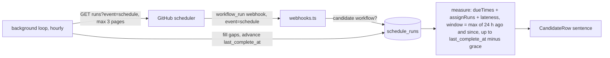

# feat: Show how GitHub actually runs each workflow still on its schedule

## Summary

Each row in the dashboard's "Still on GitHub's schedule" list will show what GitHub's own scheduler did for that workflow, in that user's own repo. For example: "GitHub ran it 3 of 16 times in the last 24 h, median 8 min late".

The data comes mostly from webhooks Cronkick already receives. A small periodic API read confirms which runs never happened. The measurement reuses the probe logic that already exists.

---

## Problem Frame

The overview lists workflows that still use GitHub's `schedule:` trigger and offers a "Move it" edit. The only reason it gives for moving is a link to the public benchmark at `/lateness`. That is generic. It shows the same numbers to every user and says nothing about this user's workflow.

The owner wants the dashboard to show the user's own data, not a comparison with GitHub everywhere. The comparison charts were moved to `/lateness` for that reason. Evidence about the user's own workflow is the one GitHub comparison that does belong on the dashboard.

---

## Requirements

- R1. For each workflow on the "Still on GitHub's schedule" list, show:
  - how many of its due times GitHub ran, out of how many were due;
  - the median delay;
  - the window the numbers cover.
- R2. Use only the installation's own repositories and workflows. Never show one account another account's data.
- R3. Never count a run as missed unless Cronkick has confirmed with GitHub that it didn't happen. A missing webhook must not look like a skipped run.
- R4. While there is too little data, say so plainly instead of showing a misleading number.
- R5. Add no new GitHub permission. Keep the API cost small and bounded.
- R6. List the new API call on `/docs/security`, which promises the complete list of calls Cronkick makes.
- R7. Delete stored measurements once they are no longer shown, and when the workflow leaves the list.

---

## Scope Boundaries

- **Not in scope:**
  - charts or strips on the dashboard (the row shows one sentence; the charts stay on `/lateness`);
  - measuring workflows already on Cronkick;
  - alerts about GitHub's lateness.
- **Not in scope:** changing how candidates are detected (`suggested_diff` in `src/sync.ts`).

### Deferred to Follow-Up Work

- Opening the evidence in the "Move it" panel: a strip of those due times. Decide this after seeing the one-line version live.
- Showing that GitHub has turned a schedule off for inactivity. GitHub sets the workflow's state to `disabled_inactivity`. Today `src/sync.ts` reads files only for workflows in the `active` state, so such workflows never become candidates. Showing them needs a separate decision.

---

## Context & Research

### Relevant Code and Patterns

- **Webhooks already arrive.** The app subscribes to **Workflow run** events (`deploy/README.md`).
  - `src/webhooks.ts` passes every `workflow_run` to `linkRun` in `src/runs.ts`.
  - `linkRun` drops everything except `event === 'workflow_dispatch'`.
  - So scheduled runs (`event: 'schedule'`) of the user's workflows already reach Cronkick and are thrown away.
- **Measurement logic to reuse** (`src/probe/stats.ts`):
  - `assignRuns` matches each run to the latest free due time at or before it;
  - `dueTimes` lists due times between two dates;
  - `lateness` gives the counts and percentiles.
- **Completeness pattern to mirror** (`src/probe/collector.ts`):
  - `collectProbes` and `probe_health` count misses only up to the last complete check, less a grace hour (`GRACE_MS`);
  - pages are capped (`PAGES`, `CAP_ERROR`);
  - each GitHub call has a timeout.
- **The candidate's crons:** `switchPlan(suggested_diff)` in `web/lib/switch.ts` parses them, with their time zones. Due times must honour the time zone; `nextDue` in `web/lib/data.ts` already does.
- **Calling GitHub as the installation:** `realGitHub` in `src/github.ts` uses Octokit with the app's installation tokens. Listing a workflow's runs is a read on Actions, which the app already holds as read and write.
- **Background work:** the `background` loop in `src/main.ts` runs the probes every 5 min and a daily reconcile. A slow GitHub call there never delays dispatching.
- **Dashboard:** `candidates` are built in `web/app/dashboard/[installationId]/page.tsx`, and each row is a `CandidateRow` in `web/components/switch-card.tsx`.
- **Migrations:** plain numbered SQL files in `migrations/`, the latest being `006_probe_bootstrap.sql`. The repo doesn't use Prisma, so new tables follow this convention.
- **Tests:** real Postgres via `test/helpers.ts` (`freshDb`, `seed`). The `fetch` is injected in the style of `test/probe.test.ts`.

### Institutional Learnings

- The trust review (`docs/design/2026-11-11-trust-review.md`) found that claims Cronkick can't back up, and permission copy that understates access, are what make the product look untrustworthy. That is why R3 and R6 exist.

### External References

- GitHub REST API, "List workflow runs for a workflow": supports the filters `event=schedule`, `created`, `per_page=100` and paging.
- Installation tokens get at least 5,000 requests per hour, and more for large installations. The plan uses a small fraction of that.

---

## Key Technical Decisions

- **Webhooks plus a confirming read, not polling alone.**
  - The `workflow_run` webhook (action `requested`) records each scheduled run as GitHub creates it, at no API cost.
  - A periodic read of that workflow's scheduled runs fills in any webhook that was lost and moves forward the point up to which misses count (R3).
  - Rationale: fresh numbers, almost no API use, and no false misses.
- **A new table, not `probe_runs`.** Probe rows are Cronkick's global benchmark. These rows belong to one installation.
  - They are keyed by GitHub `run_id`, with `workflow_id` referencing `workflows(id) ON DELETE CASCADE`, so access follows the existing workflow → repo → installation scoping (R2).
  - A small per-workflow health row holds `last_complete_at`, `last_error` and `since` (when measuring began), like `probe_health`.
- **Due times come from the candidate's crons in `suggested_diff`.** That is exactly what GitHub is running. Use each cron's own time zone. When the crons change, measuring restarts from that moment.
- **Window: the last 24 h, never earlier than measuring began.** When less than 24 h is covered, the row states the actual window ("since 09:10").
- **Too little data (R4):** show a number only once at least 3 due times are confirmed. Until then:
  - "Measuring how GitHub runs this one…" for a new candidate;
  - for slow schedules, such as a daily one, show the count anyway and name the window: "GitHub ran it 1 of 1 time since Nov 10".
- **Read cadence:** once an hour per candidate workflow, from the `background` loop.
  - At most 3 pages, enough for an every-5-minutes schedule over 24 h.
  - Only installations that are active and have candidates.
  - The cost is bounded by candidates × 3 requests per hour.
- **Retention (R7):** keep 48 h of rows. Delete a workflow's rows when it stops being a candidate: moved, dismissed with "keep it on GitHub", or deleted. A dismissed workflow isn't measured.

---

## Open Questions

### Resolved During Planning

- *Does this need a new permission?* No. Actions: read and write is already granted (R5).
- *Rate limits?* Bounded to 3 requests per hour per candidate, against at least 5,000 per hour per installation.
- *Where are the GitHub-side crons?* They are the crons in `suggested_diff`, with their time zones.

### Deferred to Implementation

- Exact Octokit call and paging helper. `realGitHub` has an `all` pager to reuse or bound.
- Whether the confirming read should use GitHub's `created` filter or stop at the boundary, as `collectProbes` does.

---

## High-Level Technical Design

> Directional sketch of the data flow.

---

## Implementation Units

### U1. Store scheduled runs of candidate workflows

**Goal:** a table for one installation's scheduled runs, plus health, with cleanup.

**Requirements:** R2, R7

**Dependencies:** none

**Files:**
- Create: `migrations/007_schedule_runs.sql`
- Modify: `src/maintenance.ts` (pruning)
- Test: `test/schedule-runs.test.ts`

**Approach:**
- `schedule_runs`: `run_id` (primary key), `workflow_id` (references workflows, cascades on delete), `due_at`, `created_at`.
- `schedule_watch`: `workflow_id` (primary key, cascades), `crons_key`, `since`, `last_complete_at`, `last_error`, `last_error_at`.
- Maintenance deletes rows older than 48 h, and watches and rows for workflows that are no longer candidates.

**Patterns to follow:** `migrations/005_probe_health.sql`, `migrations/006_probe_bootstrap.sql`.

**Test scenarios:**
- Deleting a workflow removes its runs and its watch.
- Pruning removes runs older than 48 h and keeps newer ones.
- When a workflow's `suggested_diff` becomes null (it was moved) or it is dismissed, its watch and runs are removed on the next maintenance pass.

**Verification:** the migration applies to a fresh test database, and the scenarios above pass.

### U2. Record scheduled runs from the webhook

**Goal:** a `workflow_run` with `event: 'schedule'` for a candidate workflow becomes a stored run.

**Requirements:** R1, R2

**Dependencies:** U1

**Files:**
- Modify: `src/webhooks.ts`, `src/runs.ts` (or a new `src/schedule-watch.ts`)
- Test: `test/schedule-runs.test.ts`

**Approach:**
- On `workflow_run` where `event === 'schedule'`, look up the workflow by `workflow_id`.
- It must be a candidate: present, with `suggested_diff` set, not dismissed, and in an active installation.
- The workflow lookup already scopes it to the installation (R2).
- Assign the due time with `assignRuns` against the stored rows, as `collectProbes` does. Insert with `ON CONFLICT DO NOTHING`, since `requested` and `completed` both arrive.
- Create the watch row (`since = now`) on the first sighting if it doesn't exist.
- Leave the existing `linkRun` path for `workflow_dispatch` untouched.

**Patterns to follow:** the probe re-assignment in `collectProbes`, which marks stored due times as taken.

**Test scenarios:**
- A scheduled run of a candidate is stored with the right due time.
- The `requested` then `completed` events for the same run store one row.
- A scheduled run of a workflow that isn't a candidate (already on Cronkick, dismissed, or unknown) is ignored.
- A `workflow_dispatch` run still links to its slot as before (regression).
- Two runs created in the same cron interval go to two different due times, as `assignRuns` does.

**Verification:** the webhook tests pass, and the existing `linkRun` tests are unchanged and pass.

### U3. Confirm with an hourly read

**Goal:** fill in lost webhooks and move forward the point up to which misses count.

**Requirements:** R3, R5

**Dependencies:** U1, U2

**Files:**
- Modify: `src/github.ts` (list a workflow's scheduled runs, bounded pages, with a timeout), `src/main.ts` (background loop)
- Create: `src/schedule-watch.ts` (collect step)
- Test: `test/schedule-runs.test.ts`

**Approach:**
- Every hour, for each candidate in an active installation:
  - read `GET /repos/{owner}/{repo}/actions/workflows/{id}/runs?event=schedule`, newest first;
  - stop at `last_complete_at` less the grace hour, or after 3 pages;
  - insert the runs not already stored.
- On success, set `last_complete_at` to now. On failure or hitting the cap, record `last_error` and leave `last_complete_at` where it was.
- When the candidate's crons change (`crons_key`), reset `since` and delete its rows.
- One failing installation must not stop the others.

**Patterns to follow:** `collectProbes` for the boundary, cap, error and health updates; the `lastProbe` timing in `src/main.ts`.

**Test scenarios:**
- A run missed by the webhook but returned by the read is stored.
- A successful read moves `last_complete_at` forward.
- A non-200 response or timeout records `last_error` and leaves `last_complete_at` unchanged.
- An every-5-minutes candidate with 288 runs a day reads at most 3 pages and stops at the boundary.
- A crons change resets `since` and clears the rows.
- Installations that are removed or suspended are skipped.

**Verification:** the tests pass with an injected `fetch`, and no read happens for an installation without candidates.

### U4. Measure each candidate

**Goal:** for each candidate, its numbers for the dashboard, or a "measuring" state.

**Requirements:** R1, R3, R4

**Dependencies:** U1

**Files:**
- Modify: `web/lib/data.ts` (one query for an installation's candidates)
- Test: `test/dashboard.test.ts`

**Approach:**
- Window start: the later of 24 h ago and `since`.
- Window end: `last_complete_at` less the grace hour.
- Due times: `dueTimes` for each cron in the window, in the cron's time zone.
- `ran`: stored runs whose due time is in the window.
- Median delay over those runs.
- Return `{ ran, expected, p50Sec, from, until }`, or `{ measuring: true, since }` when fewer than 3 due times are confirmed or no read has completed yet.

**Test scenarios:**
- 16 due times with 3 runs gives 3 of 16 and the right median.
- Due times after `last_complete_at` less the grace hour are not counted as missed, even with no rows (R3).
- 2 confirmed due times gives the measuring state.
- A daily cron one day in gives 1 of 1 with `from` named.
- A cron with a time zone (`0 6 * * *`, Europe/London) gives due times at 06:00 London time, across a daylight-saving change.
- Another installation's candidate is never returned (R2).

**Verification:** the tests pass, with one query for all of an installation's candidates.

### U5. Show it on the "Move it" row

**Goal:** one honest sentence per candidate, and an up-to-date list of calls on `/docs/security`.

**Requirements:** R1, R4, R6

**Dependencies:** U4

**Files:**
- Modify:
  - `web/app/dashboard/[installationId]/page.tsx` (add the measurement to each `Candidate`)
  - `web/components/switch-card.tsx` (render it)
  - `web/app/docs/security/page.tsx` (add the call)
- Test: `test/live.test.ts` (the sentence formatter)

**Approach:**
- The row's summary shows the sentence under the workflow name:
  - "GitHub ran it 3 of 16 times in the last 24 h · median 8 min late";
  - "GitHub ran it 1 of 1 time since Nov 10 · 12 min late";
  - "Measuring how GitHub runs this one…".
- Red text only when misses are 10% or more. Otherwise plain text.
- No charts.
- `/docs/security` adds `GET /repos/…/actions/workflows/…/runs` with the reason "Check how GitHub ran workflows that still use its own schedule, to show you the difference." Update the `src/github.ts` comment that keeps the two in sync.

**Test scenarios:**
- The formatter produces each wording above, singular and plural.
- 0 of N runs reads "GitHub ran it 0 of 16 times".
- A missing measurement renders the existing row unchanged.

**Verification:** the formatter tests pass, and the demo seed (`scripts/demo-seed.ts` account 6) shows all three states.

---

## System-Wide Impact

- **Interaction graph:** the webhook handler gains a branch, and the background loop gains an hourly step. Dispatching and the maintenance loop are unaffected.
- **API surface parity:** `/docs/security` must list the new call (R6). The privacy page needs no change, since the data is already within the app's access.
- **Error propagation:**
  - read errors are recorded per workflow and never thrown out of the loop;
  - the dashboard falls back to the measuring state.
- **Unchanged invariants:**
  - the `workflow_dispatch` linking in `linkRun`;
  - candidate detection in `src/sync.ts`;
  - the probe benchmark and `/lateness`.

---

## Risks & Dependencies

| Risk | Mitigation |
|------|------------|
| A lost webhook looks like a skipped run | Misses count only up to the last complete hourly read, less the grace hour (R3) |
| A busy repo's runs exceed 3 pages | The boundary stops paging early. Hitting the cap records an error and doesn't advance, the same as the probe |
| Users read it as Cronkick blaming GitHub | Plain wording, counts rather than percentages, and red only at 10% or more misses |
| Webhook backlog or replay storms | The insert is idempotent on `run_id` |

---

## Sources & Research

- Webhook subscription: `deploy/README.md` ("Subscribe to events: Push, Workflow run")
- Permissions and promised calls: `web/app/docs/security/page.tsx`
- Measurement and completeness pattern: `src/probe/collector.ts`, `src/probe/stats.ts`
