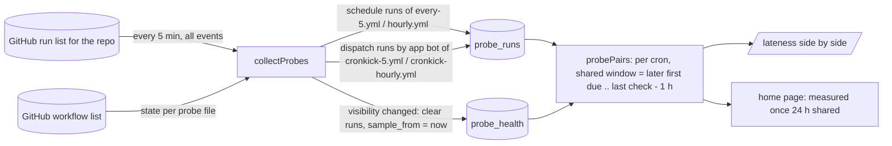

# feat: Measure Cronkick and GitHub's schedule side by side on /lateness

## Summary

`/lateness` currently measures only GitHub, so nothing on it shows that Cronkick is better. This plan puts a Cronkick-triggered twin next to each GitHub probe, in the same public repo, with the same cron, measured by the same code from GitHub's own run list. `/lateness` then shows each pair side by side, with links that let anyone check the runs. Once the sample is big enough, the home page uses the measured numbers instead of its illustration.

---

## Problem Frame

People can't tell from `/lateness` whether Cronkick is better, because Cronkick isn't on it. A believable comparison needs four things:
- the same measurement for both sides;
- data neither side controls, which is GitHub's run list;
- the same conditions: same repo, same cron, same window;
- runs anyone can open and check.

It also must not mislead: no inflated Cronkick numbers, and no GitHub failures that are really something else.

Data measured on Nov 11 in `Deveshb15/cronkick-probe-a`, from GitHub's run list:

| Workflow | Triggered by | Ran | Typical | Worst 5% |
|---|---|---|---|---|
| `cronkick.yml` (every 15 min) | Cronkick | every due time | 1 s | 2 s |
| `every-5.yml` (every 5 min) | GitHub `schedule:` | 4 of ~211 | 1 min 42 s | 4 min 52 s |
| `hourly.yml` (every hour) | GitHub `schedule:` | 4 of ~17 | 44 min | 59 min |

---

## Requirements

- R1. Each GitHub probe schedule has a Cronkick twin with the same cron in the same repo: every 5 minutes and every hour.
- R2. Both sides are measured identically: from the scheduled minute to GitHub creating the run, read from GitHub's run list by the same collector.
- R3. A twin counts only runs triggered by the Cronkick app. Manual "Run workflow" clicks don't count.
- R4. A pair is compared only over the time both sides were being measured. Both sides start at the later of their first recorded runs and end at the repo's last complete check, less the grace hour.
- R5. When a probe repo's visibility changes, its sample restarts, so every published number was measured under the conditions shown.
- R6. A workflow that GitHub (or anyone) has disabled is shown as paused, not counted as missed runs.
- R7. `/lateness` shows each pair side by side:
  - the paired headline numbers;
  - stacked run-by-run strips over the same due times;
  - a "how late" dot chart with two lanes;
  - links to both workflows' run lists on GitHub when the repo is public.
- R8. While a pair's shared window is shorter than 6 h, it shows "Collecting since …" instead of numbers. The page states the repo count, visibility and sample age.
- R9. The home page shows the measured comparison once the every-5-minutes pair has at least 24 h of shared window. Until then it keeps today's illustration.
- R10. The steps the owner takes on GitHub and in production are listed as prerequisites.

---

## Prerequisites (owner actions, outside the code)

These come first. The code works without them, but the pairs only appear once they're done.

1. **Probe account on Pro.**
   - The every-5-minutes twin is faster than Free allows, so Cronkick would flag it instead of running it.
   - There is no billing flow yet, so this is a one-row database change on production: set `plan = 'pro'` for the probe repo's installation. The owner approves it, and it's run once.
2. **Add the twin workflows** to `cronkick-probe-a`, copied from `probe/workflows/cronkick-5.yml` and `cronkick-hourly.yml` (added in U5).
   - They use the same job as the GitHub probes.
   - They are triggered by `workflow_dispatch` with a `# cronkick:` marker.
3. **Make `cronkick-probe-a` public** (Settings → General → Danger Zone).
   - Public repos run Actions free, so the every-5-minutes pair costs nothing.
   - The sample restarts automatically when the visibility changes (R5).
4. **Keep the repo active.** Public repos' schedules turn off after 60 days without commits. Push an empty commit monthly. U1 detects a turned-off schedule either way (R6).
5. `PROBE_REPOS` already lists the repo. `PROBE_TOKEN` keeps working; public repos don't strictly need it.
6. Leave `cronkick.yml` (every 15 min) in place. It isn't part of a pair, so it is excluded.

---

## Scope Boundaries

- Not in scope:
  - fleet-wide Cronkick stats from our own database (they would be self-reported, not GitHub-sourced);
  - more probe repos;
  - the dashboard;
  - alerting on probe health.
- Not in scope: a billing or admin path to set Pro. Prerequisite 1 is a one-off.

### Deferred to Follow-Up Work

- A second, older public repo, so the page doesn't rest on one young repo, which is GitHub's worst case.
- An empty commit made automatically every month to keep public probes active.

---

## Context & Research

### Relevant Code and Patterns

- **`src/probe/collector.ts`**
  - `collectProbes` reads `GET /repos/{repo}/actions/runs?event=schedule` across the whole repo, newest first. It pages to the last complete check less the grace hour, capped at 10 pages.
  - It assigns runs to due times per entry in `PROBE_WORKFLOWS` with `assignRuns`.
  - Health is kept in `probe_health` (`last_success_at`, `bootstrap_at`, `private`).
  - `probeReport` counts per workflow from that repo's first stored due time.
  - `probeStrips` draws the latest 96 due times for one repo.
- **`src/probe/stats.ts`**: `PROBE_WORKFLOWS` (file and cron), `assignRuns`, `dueTimes`, `lateness`, `GRACE_MS`.
- **`web/components/probe-charts.tsx`**: the current GitHub-only `/lateness` charts. It already has the tabs, headline numbers, strip and log-scale dots that this plan generalises to pairs.
- **`web/app/lateness/page.tsx`**: the sample box, the charts, and a table per cron. With twins, crons repeat, so the table needs a "Triggered by" column.
- **`web/app/page.tsx`**: the "The problem" section shows `TimelineCompare` (`web/components/timeline-compare.tsx`), labelled "Illustration".
- **`probe/workflows/*.yml`** and **`probe/README.md`**: the probe templates and setup notes.
- **Run objects** from GitHub's list carry `event`, `path`, `created_at` and `triggering_actor { login, type }`. Dispatches made with the app's installation token show `triggering_actor.login` as `<app slug>[bot]` (`GITHUB_APP_SLUG`, `appSlug()`).
- **Workflow state:** `GET /repos/{repo}/actions/workflows` returns each workflow's `state` (`active`, `disabled_inactivity`, `disabled_manually`).

### Institutional Learnings

- `docs/design/2026-11-11-trust-review.md`: claims Cronkick can't back up are what make it look untrustworthy. Every number must be reproducible from GitHub.

---

## Key Technical Decisions

- **One read for the whole repo, filtered per workflow.**
  - Drop `event=schedule` from the repo-wide run list.
  - Each `PROBE_WORKFLOWS` entry declares its trigger:
    - GitHub probes: `event = schedule`;
    - twins: `event = workflow_dispatch` with the app's bot as `triggering_actor`.
  - This keeps the same paging, boundary and cap logic, so both sides share the "last complete check" (R2, R3).
  - The extra traffic is `cronkick.yml`'s 96 runs a day, well inside the 1,000-run cap at a 5-minute cadence.
- **Pairs are entries with the same cron.** `PROBE_WORKFLOWS` gains `via: 'github' | 'cronkick'`. The pairs are every 5 minutes and hourly.
- **Shared window per pair (R4).**
  - Start: the later of each side's first stored due time and the repo's `sample_from`.
  - End: the repo's last complete check, less the grace hour.
  - Applying the same rule to both sides is what makes it fair. Neither side's quiet start is counted against it, and neither side is shown over a period the other wasn't measured.
- **Visibility restarts the sample (R5).**
  - New column `probe_health.sample_from`.
  - When a check sees a repo's `private` flag differ from the stored one, it deletes that repo's `probe_runs`, sets `sample_from = now`, and ignores runs created before it.
- **Disabled workflows pause, not miss (R6).**
  - Each check reads the repo's workflow list (one request) and stores each probe workflow's state.
  - A pair with either side not `active` shows "Paused: GitHub turned this schedule off after 60 days without commits" (or "disabled manually").
  - It shows no numbers while paused.
  - Due times while it was disabled are never counted, because counting stops at the moment the state was first seen to change.
- **Thresholds.**
  - A pair shows numbers once its shared window is at least 6 h.
  - The home page switches once the every-5-minutes pair has at least 24 h.
  - Both are constants next to `PROBE_WORKFLOWS`.
- **"Within 30 s" stays the colour rule for both sides.** Cronkick's deliberate spread of up to 15 s at the top of the hour counts against it, which is honest.
- **No Cronkick database data on the page.** Every number comes from GitHub's run list.

---

## High-Level Technical Design

Pair states, as shown on the page:

| State | When | Shows |
|---|---|---|
| Collecting | shared window shorter than 6 h, or one side has no runs yet | "Collecting since …" and what is missing |
| Paused | either workflow is not `active` | the reason, no numbers |
| Compared | otherwise | the paired numbers, strips and dots |

---

## Implementation Units

### U1. Collector: both triggers, visibility restart, workflow state

**Goal:** collect twin runs with exactly the GitHub probe pipeline, restart a repo's sample when its visibility changes, and record each probe workflow's state.

**Requirements:** R2, R3, R5, R6

**Dependencies:** none

**Files:**
- Modify: `src/probe/stats.ts` (`PROBE_WORKFLOWS` with `via`, `event`), `src/probe/collector.ts`, `src/config.ts` (pass the app slug)
- Create: `migrations/008_probe_pairs.sql` (`probe_health.sample_from`, and a `probe_workflows` table holding repo, path, state and checked time)
- Test: `test/probe.test.ts`, `test/db.test.ts` (migration list and table count)

**Approach:**
- Read the repo-wide run list without the event filter.
- A run counts for an entry only when its `path` and `event` match the entry. For twins, `triggering_actor.login` must also be the app's bot.
- On each check:
  - read the workflow list and upsert the state of each probe file;
  - compare the `private` flag with the stored one, and on a change clear the repo's runs and set `sample_from`;
  - skip storing runs created before `sample_from`.
- Keep the existing boundary, cap and health semantics unchanged.

**Patterns to follow:** the current `collectProbes` paging and health updates; the `test/probe.test.ts` fake GitHub (`github([...pages])`).

**Test scenarios:**
- A twin run dispatched by `cronkick[bot]` is stored against `cronkick-5.yml`. A manual dispatch by a user on the same workflow is ignored.
- A `schedule` run of `every-5.yml` is stored as before (regression). A `workflow_dispatch` run of `every-5.yml` is ignored.
- `private: true` stored, then a check sees `private: false`: earlier runs are deleted, `sample_from` is set, and runs created before it in that batch are not stored.
- Same visibility on the next check: nothing is cleared.
- The workflow list reports `disabled_inactivity` for `hourly.yml`: the stored state is updated.
- The workflow-list call fails: the run collection still proceeds, and the error is recorded as for run reads.
- Existing boundary, cap and bootstrap tests still pass.

**Verification:** the probe tests pass, and the twins' rows appear in `probe_runs` with the same `cron` as their GitHub pair.

### U2. Report pairs over a shared window

**Goal:** turn stored runs into per-cron pairs with honest states.

**Requirements:** R4, R6, R8

**Dependencies:** U1

**Files:**
- Modify: `src/probe/collector.ts` (`probePairs`, built on the existing `probeReport` and `probeStrips` logic; `probeStrips` absorbed or reused)
- Test: `test/probe.test.ts`

**Approach:**
- For each cron with both a `github` and a `cronkick` entry:
  - work out the shared window by the rule in the key decisions, from the contributing repo(s);
  - compute each side's `lateness` over the same due times;
  - return the latest 96 shared due times for each side's strip, so the strips line up tick for tick.
- Return the state: Collecting (with reason), Paused (with which side and why), or Compared.
- Keep `probeReport` for the existing per-workflow table.

**Test scenarios:**
- GitHub's first run 10:00, twin's first run 14:00, last check 22:00: both sides counted from 14:00 to 21:00 only.
- Shared window of 5 h: Collecting; at 6 h: Compared.
- Twin has no runs yet: Collecting, naming the twin.
- Either side's workflow state is `disabled_inactivity`: Paused with that reason, and no stats returned.
- Twin ran every due time within 2 s while GitHub ran 4 of 72: stats match, and both strips have the same due times in the same order.
- `sample_from` later than both first runs: the window starts at `sample_from`.

**Verification:** the pair tests pass. Running it against today's demo seed returns two pairs.

### U3. `/lateness` side by side

**Goal:** a per-cadence comparison anyone can check.

**Requirements:** R7, R8

**Dependencies:** U2

**Files:**
- Modify: `web/components/probe-charts.tsx` (becomes the pair view), `web/app/lateness/page.tsx`
- Test: `test/live.test.ts` (any new formatting helper), and a visual check

**Approach:**
- Tabs per cadence, as now.
- For each pair:
  - headline rows (ran when due, typical delay, worst 5%), each with GitHub and Cronkick values side by side;
  - stacked strips (Cronkick, then GitHub) over the same due times, with tooltips;
  - a two-lane dot chart on the existing log scale;
  - a line "Same repo · same cron · measured from GitHub's run list";
  - "See these runs on GitHub" links to both workflows' Actions pages, only when the repo is public.
- Collecting and Paused states replace the charts with one clear sentence.
- The hero copy says what is compared and how.
- The table gains a "Triggered by" column (GitHub `schedule:` or Cronkick).
- The sample box keeps the repo count, visibility and sample start.

**Patterns to follow:** the existing `ProbeCharts` layout, container queries and `.tip` tooltips; `@max-xl:` for container-max variants.

**Test scenarios:**
- Test expectation: the formatting helpers covered in `test/live.test.ts` if any are added. Layout is verified visually at 1440 and 390 px for Compared, Collecting and Paused (demo seed, U5).

**Verification:**
- The page renders all three states from the demo seed.
- No horizontal scroll at 390 px.
- The links point to `https://github.com/<repo>/actions/workflows/<file>`.

### U4. Home page: measured once there is enough

**Goal:** replace the illustration with the measured every-5-minutes pair once it has at least 24 h of shared window.

**Requirements:** R9

**Dependencies:** U2, U3

**Files:**
- Modify: `web/app/page.tsx`
- Reuse: the pair strip from U3, in a compact form; `web/components/timeline-compare.tsx` stays as the fallback

**Approach:**
- In "The problem" section, fetch the pairs.
- When the every-5-minutes pair is Compared with at least 24 h:
  - show its two strips and the two headline numbers;
  - use copy that drops "illustration";
  - link to `/lateness`.
- Otherwise keep the current illustration and copy unchanged.
- A failure to read the pairs falls back to the illustration.

**Test scenarios:**
- Pair at 30 h: the measured view renders.
- Pair at 10 h, or Paused: the illustration renders.
- Probe read throws: the illustration renders and the page returns 200.

**Verification:** both branches render from the demo seed (rich mode and thin mode).

### U5. Probe templates, docs and demo seed

**Goal:** make the owner steps reproducible and the states demoable.

**Requirements:** R1, R10

**Dependencies:** U1

**Files:**
- Create: `probe/workflows/cronkick-5.yml`, `probe/workflows/cronkick-hourly.yml` (same job as the GitHub probes, `workflow_dispatch` plus a `# cronkick:` marker)
- Modify: `probe/README.md` (pairs, public repos, Pro for the probe account, monthly empty commit, the sample restarting when visibility changes), `scripts/demo-seed.ts` (twin runs; a `DEMO_PROBES` mode for each of Compared, Collecting and Paused)

**Test scenarios:**
- Test expectation: none for templates and docs. The seed is exercised by the U3 and U4 visual checks.

**Verification:** the templates parse with Cronkick's marker check (`checkWorkflow` raises no flags), and the README lists every prerequisite.

---

## System-Wide Impact

- **Interaction graph:** only the probe collector's read changes. Dispatching, the dashboard and webhooks are untouched.
- **API surface:**
  - One extra GitHub request per probe check (the workflow list).
  - The run list now includes dispatch runs, about 384 more runs a day per repo with both twins, still well under the 1,000-run cap per 5-minute check.
  - `/docs/security` is unaffected, because probes use `PROBE_TOKEN` on our own repos.
- **Unchanged invariants:**
  - a failed or partial check is never counted as a miss;
  - the grace hour;
  - the 7-day window.

---

## Risks & Dependencies

| Risk | Mitigation |
|------|------------|
| Twin numbers inflated by manual dispatches | Count only runs triggered by the app's bot (R3) |
| Comparing different periods | One shared window per pair (R4) |
| Numbers from before the repo went public | The sample restarts when visibility changes (R5) |
| GitHub turning a schedule off reads as "never ran" | Workflow state is read each check; such a pair shows Paused (R6) |
| One young repo is GitHub's worst case, and the page overstates the gap | Sample age and repo count are shown, and a second, older public repo is deferred follow-up work |
| Cronkick outage makes its twin look bad | Intended: it's measured from GitHub, so an outage counts, which is honest |
| The probe account isn't on Pro, so the every-5 twin gets flagged | Prerequisite 1. Until then the pair shows Collecting, naming the missing twin |

---

## Sources & Research

- Live measurement: `Deveshb15/cronkick-probe-a` run lists on Nov 11 (table above)
- `probe/README.md`: costs, the 60-day inactivity rule, and the probe setup
- `src/probe/collector.ts` and `src/probe/stats.ts`: the existing measurement and completeness rules
