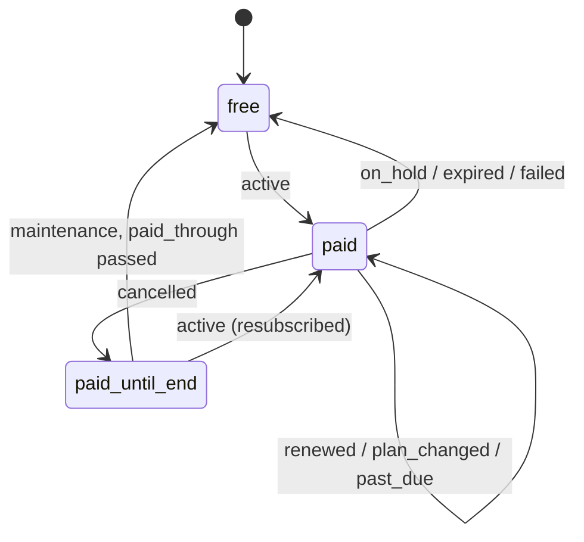

# feat: New pricing and Dodo Payments billing

## Summary

Cronkick gets new plans: Free (3 schedules), Pro for personal accounts ($5/mo, $50/yr) and Team for organizations ($19/mo, $190/yr). It also gets self-serve billing through Dodo Payments. A signed-in owner picks monthly or yearly, pays on Dodo's hosted checkout, and a signed webhook moves the installation between plans. Settings links to Dodo's customer portal so customers can manage or cancel. Every page that quotes limits or prices reads them from `src/plans.ts`.

## Problem Frame

Free (10 schedules every 15 minutes) covers almost every real user, so nobody has a reason to pay. There is no way to pay anyway. Pro is "email us and we switch you by hand" (`web/app/page.tsx` pricing, Settings, Terms, docs, support FAQ). Pricing was decided on 2026-11-12 after two independent brainstorms. Dodo is verified, and four test-mode products exist.

---

## Requirements

**Plans and limits**
- R1. Free: 3 schedules, every 15 min or slower, 7 days of history, no run-failure alerts (plan-limit notices still go out).
- R2. Pro: personal accounts only (`installations.account_type = 'User'`). 50 schedules, every 5 min, 90 days, email alerts.
- R3. Team: organizations only (`account_type = 'Organization'`). 200 schedules, every 1 min, 400 days, email alerts.
- R4. An organization can never buy Pro, and a personal account can never buy Team. This is enforced on the server, not only hidden in the UI.

**Checkout and billing**
- R5. The installation's signed-in owner starts checkout for their tier, monthly or yearly, and lands back on their dashboard.
- R6. The plan changes only through a verified Dodo webhook. A forged or replayed request changes nothing.
- R7. Cancelling keeps the paid plan until the end of the paid period. During a failed-renewal grace period (`past_due`) the plan stays. When Dodo stops the subscription (`on_hold`, `expired`, `failed`), the installation returns to Free.
- R8. Any plan change re-applies limits right away: re-read workflow files for the new floor, then pause or unpause schedules (`syncInstallation`).
- R9. Paying customers open Dodo's customer portal from Settings to update the card, see invoices or cancel.
- R10. An installation with no Dodo subscription keeps whatever plan was set by hand (`scripts/set-plan.ts`). The founder's own installation stays comped.

**Copy and docs**
- R11. The landing page, Settings, docs Plans page, support FAQ, Terms and dashboard plan labels show the new tiers and prices. Prices come from one source.
- R12. "Request Pro by email" and "No card checkout yet" disappear wherever they appear.

---

## Key Technical Decisions

- **Plan name lives on `installations.plan`; billing state lives in new columns on the same row.** The new columns are `dodo_customer_id`, `dodo_subscription_id`, `subscription_status` and `paid_through` (timestamptz). The CHECK becomes `('free','pro','team')`. One row per GitHub account is already the billing unit ("per GitHub account or organization"), so no new table.
- **The webhook lives on the worker (`src/web/app.ts`) as `POST /webhooks/dodo`, next to the GitHub webhook.** The worker owns all inbound webhooks, and `web/next.config.ts` rewrites exact paths to it. The rewrite list gains `/webhooks/dodo`.
- **Verify the Standard Webhooks signature by hand with `node:crypto`; don't add a dependency.** The scheme is HMAC-SHA256 over `${webhook-id}.${webhook-timestamp}.${body}`, base64, with a `whsec_` secret (base64 after the prefix). The `webhook-signature` header can hold several space-separated `v1,<sig>` values. Reject timestamps more than 5 minutes off. This mirrors `verifySignature` in `src/webhooks.ts`.
- **Idempotency comes from a `billing_events` table keyed on `webhook-id`.** Insert with `ON CONFLICT DO NOTHING`. If no row was inserted, return 200 and do nothing. The insert and the plan update run in one transaction, so a failure leaves no half-applied state and Dodo's retry re-runs cleanly.
- **The webhook writes state; it doesn't act on events.** On any `subscription.*` event, take the subscription from the payload: status, `product_id`, `next_billing_date`/`expires_at`, `metadata.installation_id`. Then compute the plan:
  - `active`: the product's tier.
  - `past_due`: unchanged.
  - `cancelled`: the product's tier until `paid_through`, then Free (applied by maintenance, see below).
  - `on_hold`, `expired` or `failed`: Free.

  Out-of-order delivery can't regress state: ignore an event whose `timestamp` is older than the last applied one for that subscription.
- **Product to tier comes from env, not names.** `DODO_PRODUCT_PRO_MONTHLY`, `DODO_PRODUCT_PRO_YEARLY`, `DODO_PRODUCT_TEAM_MONTHLY` and `DODO_PRODUCT_TEAM_YEARLY` hold the IDs. Test and live use different IDs, and an unknown product is logged and ignored, never mapped to Free.
- **Checkout is a Next server action in Settings.** It calls `requireInstallation`, then picks the product from `account_type` and the chosen interval. It creates a Dodo checkout session with `metadata.installation_id`, the customer's GitHub login as the name, `return_url = /dashboard/{id}/settings?checkout=done`, and `cancel_url` back to Settings. Then it redirects to `checkout_url`. If the installation already has a subscription, the action refuses, and Settings shows "Manage billing" instead.
- **Cancellation at period end is handled by the existing maintenance loop (`src/maintenance.ts`).** Each pass it moves installations with `subscription_status = 'cancelled' AND paid_through < now()` to Free and syncs them. This avoids trusting Dodo to send a second event at period end.
- **History retention becomes per-plan.** The 91-day delete in `src/maintenance.ts` turns into a delete joined to the installation's plan: Free and Pro keep 91 days, Team keeps 401. Data a downgrade hides isn't deleted until the next prune for the new plan.
- **Rate-limit guard for one-minute schedules:** Team allows 200 schedules, but GitHub gives each installation about 5,000 API calls an hour. Before Team launches, measure API calls per dispatch in `src/github.ts` (one dispatch plus run linking). Then pick one:
  - cap one-minute schedules per installation in `applyLimits`, as a ponytail-marked limit;
  - document the budget in the docs.

  The numbers are tracked under Open Questions.
- **Uses the `dodopayments` npm SDK** for checkout and customer-portal sessions. It's the only new dependency, and it's needed so request shapes stay correct across API versions. The webhook doesn't use it.

---

## High-Level Technical Design

```mermaid
sequenceDiagram
  participant U as Owner (browser)
  participant W as Next app (Settings action)
  participant D as Dodo
  participant K as Worker /webhooks/dodo
  participant P as Postgres
  U->>W: Upgrade (monthly / yearly)
  W->>W: requireInstallation, tier from account_type
  W->>D: checkoutSessions.create(product, metadata.installation_id, return_url)
  D-->>U: hosted checkout → pays → return_url
  D->>K: subscription.active (signed)
  K->>K: verify signature + timestamp
  K->>P: tx: insert billing_events(webhook-id) · update installations plan + billing cols
  K->>K: syncInstallation (new floor, applyLimits)
  Note over K,P: cancelled → paid_through kept; maintenance downgrades after it passes
```



---

## Implementation Units

### U1. Plans: add Team and the new limits

**Goal:** `src/plans.ts` holds the three tiers, prices and who can buy each. Every branch on `'pro'` handles Team.
**Requirements:** R1, R2, R3, R11
**Dependencies:** none
**Files:** `src/plans.ts`, `migrations/010_billing.sql` (CHECK constraint only here, columns in U2), `src/alerts.ts`, `src/maintenance.ts`, `web/lib/data.ts`, `web/components/dash-nav.tsx`, `web/components/account-switcher.tsx`, `web/app/dashboard/page.tsx`, `web/app/dashboard/[installationId]/page.tsx`, `web/app/dashboard/[installationId]/workflows/[workflowId]/page.tsx`, `scripts/set-plan.ts`, `test/helpers.ts`, `test/plans.test.ts`, `test/sync.test.ts`
**Approach:**
- Add `team` to `PlanName` and `PLANS` with `schedules`, `floorMinutes`, `historyDays`, plus `price: { monthly, yearly }` and `for: 'User' | 'Organization' | null`.
- Add `paid(plan)` and `planLabel(plan)` helpers. They replace the scattered `plan === 'pro'` checks: the alert SQL becomes `plan IN ('pro','team')`, and labels, range lists and the dashboard heatmap days use them.
- Remove `historyRows`, which is always null.
- Make retention in `src/maintenance.ts` per plan.
- `scripts/set-plan.ts` accepts `team`.

**Patterns to follow:** existing `PLANS` usage. `rangesFor` in `web/lib/data.ts`.
**Test scenarios:**
- Free installation with 5 active schedules: `applyLimits` keeps the oldest 3 and pauses 2.
- Team installation: a `*/1` marker is not flagged. On Pro the same marker is flagged with "your plan allows every 5 min".
- Run alerts query: a failed run on a Team installation with an alert email produces an alert. On Free it doesn't.
- Retention: a Team slot 200 days old survives the prune. A Pro slot 200 days old is deleted.
- `set-plan` with `team` is accepted. With `gold` it prints usage.

**Verification:** no `=== 'pro'` remains outside `src/plans.ts` (grep). Existing tests pass with fixtures updated for the new Free limit.

### U2. Billing schema and webhook

**Goal:** a verified, idempotent `POST /webhooks/dodo` keeps `installations` in sync with Dodo subscriptions.
**Requirements:** R6, R7, R8, R10
**Dependencies:** U1
**Files:** `migrations/010_billing.sql`, `src/billing.ts` (new: signature check, payload to state, apply), `src/web/app.ts`, `src/config.ts`, `src/main.ts`, `web/next.config.ts`, `test/billing.test.ts`
**Approach:**
- Migration:
  - plan CHECK becomes `('free','pro','team')`;
  - add the `installations` columns `dodo_customer_id`, `dodo_subscription_id`, `subscription_status`, `paid_through`, `billing_updated_at`;
  - add a `billing_events (webhook_id text PRIMARY KEY, type text, received_at timestamptz)` table.
- `DODO_WEBHOOK_SECRET` is optional in `loadConfig`. When it isn't set, the route answers 503 so a missing secret fails loudly instead of accepting anything.
- Handler order:
  1. verify;
  2. parse;
  3. ignore non-`subscription.*` events (record them only);
  4. resolve the installation from `metadata.installation_id`, falling back to `dodo_subscription_id` (later events may not echo metadata), and ignore an unknown one with a Sentry note;
  5. map the product to a tier;
  6. in a transaction, insert the event, skip a stale timestamp, update the row;
  7. after commit, `syncInstallation`.
- A subscription whose product doesn't match the account type (an org on a Pro product) is recorded and reported to Sentry, but the plan doesn't change. Checkout prevents this, so reaching it means tampering.

**Execution note:** test-first. Start with the signature tests and the event-to-state table.
**Patterns to follow:** `verifySignature` and the `/webhooks` route in `src/web/app.ts` (Sentry capture, 500 on failure so the sender retries).
**Test scenarios:**
- A valid signature with `subscription.active` for the Pro monthly product on a User installation gives plan `pro` and stores the subscription ID and `paid_through`. Covers R6.
- A bad signature, a missing header, or a timestamp 10 minutes old each get 401, and the database is unchanged.
- The same `webhook-id` delivered twice is applied once. The second delivery returns 200.
- A signature header holding two `v1,` values where the second is valid is accepted.
- `subscription.past_due` keeps plan `pro`.
- `subscription.cancelled` keeps plan `pro`, sets status cancelled and keeps `paid_through`.
- `subscription.on_hold` gives `free`, and the installation's 4th to 50th schedules are paused.
- An event older than the last applied one is ignored.
- An unknown product ID changes nothing and returns 200.
- A Team product on a User installation records billing and leaves the plan unchanged.
- An installation with no subscription (comped) never gets a webhook, and its plan stays `pro`. Covers R10.
- A 1-minute marker on an installation moved to Team becomes active after the sync. Covers R8.

**Verification:** `test/billing.test.ts` passes against local Postgres. `curl` with a bad signature to the worker returns 401.

### U3. Period-end downgrade in maintenance

**Goal:** a cancelled subscription drops to Free once `paid_through` passes.
**Requirements:** R7, R8
**Dependencies:** U2
**Files:** `src/maintenance.ts`, `test/maintenance.test.ts`
**Approach:** each pass, select installations with `subscription_status = 'cancelled' AND paid_through < now() AND plan <> 'free'`, set them to Free and sync each. Use `FOR UPDATE SKIP LOCKED` or an update-returning statement, so two servers don't both sync.
**Patterns to follow:** existing maintenance steps and their `now` injection.
**Test scenarios:**
- Cancelled with `paid_through` yesterday: Free after a pass, schedules over 3 paused.
- Cancelled with `paid_through` tomorrow: still paid.
- Cancelled and then `active` again (resubscribed): not downgraded.

**Verification:** maintenance tests pass.

### U4. Checkout and Manage billing in Settings

**Goal:** owners can buy the right tier and manage it themselves.
**Requirements:** R4, R5, R9, R12
**Dependencies:** U1, U2
**Files:** `web/lib/billing.ts` (new: Dodo client, `tierFor(account_type)`, product ID lookup), `web/app/dashboard/[installationId]/settings/actions.ts`, `web/app/dashboard/[installationId]/settings/page.tsx`, `web/components/dash-nav.tsx`, `package.json`, `test/billing-web.test.ts`
**Approach:**
- Server actions:
  - `startCheckout(id, interval)` and `openBillingPortal(id)`, both guarded by `requireInstallation`.
  - The checkout action reads `account_type` and the existing subscription from the database, never from the form.
  - The portal action creates a customer-portal session for `dodo_customer_id`.
- Settings plan card:
  - a monthly/yearly choice for the one tier this account can buy;
  - "Manage billing" when a subscription exists;
  - a "Payment received, your plan updates in a few seconds" note on `?checkout=done`, which live updates already refresh;
  - the plan table shows Free and the account's paid tier only.
- Dash-nav upsell links to Settings with the account's tier and limits.
- Env: `DODO_PAYMENTS_API_KEY`, `DODO_PAYMENTS_ENVIRONMENT` (`test_mode` | `live_mode`) and the four product IDs. When they're missing, Settings shows the plan but hides the buttons.

**Patterns to follow:** `saveAlertEmail` in `settings/actions.ts`. `ButtonLink` and the existing plan table.
**Test scenarios:**
- `tierFor('Organization')` is team. `tierFor('User')` is pro.
- The product lookup returns the yearly Team ID for org plus yearly.
- The checkout action for an org installation always uses a Team product, even if the form says `pro`. Covers R4.
- The checkout action refuses when the installation already has an active subscription.
- The checkout action for an installation the session doesn't own redirects to login. Covers R5's access rule.
- The Dodo client is a stub; the test asserts `metadata.installation_id`, `return_url` and the product.

**Verification:** unit tests pass. A manual test-mode purchase with Dodo's test card turns the installation Pro within seconds.

### U5. Pricing copy across the site

**Goal:** every public page states the new plans, with numbers taken from `PLANS`.
**Requirements:** R11, R12
**Dependencies:** U1
**Files:** `web/app/page.tsx` (pricing cards, FAQ, comparison rows), `web/app/docs/plans/page.tsx`, `web/app/support/page.tsx`, `web/app/terms/page.tsx`, `web/app/refunds/page.tsx`
**Approach:**
- Three pricing cards: Free, Pro ("for personal accounts") and Team ("for organizations"). Each card's CTA is "Install free" or "Get Pro"/"Get Team", which signs in and goes to Settings.
- Remove "manual activation" wording.
- Terms: "Pro costs $5 a month or $50 a year for a personal account; Team costs $19 a month or $190 a year for an organization."
- Support FAQ: the Pro answer becomes "upgrade in Settings; cancel any time from Manage billing".
- Docs Plans page: a short note on GitHub's API budget for one-minute schedules.

**Test expectation:** none, copy only. Read it through on each page.
**Verification:** grep finds no `$9`, `$90`, "manual activation", "Request Pro" or "No card checkout" in `web/`.

---

## Scope Boundaries

- Live mode is out of scope. Creating live products, live keys, the live webhook and the brand rename are dashboard steps for the founder at go-live, done by changing env values only.
- No coupons, trials, seat pricing, proration UI or invoices beyond Dodo's own portal.
- Deploying and adding env values on the servers are separate steps that need approval.

### Deferred to Follow-Up Work

- A "1 year" range in history filters for Team. The current ranges stay. Older days are reachable through the per-day view.
- Weekly digest email for Free.

---

## Open Questions

- **One-minute rate budget (decide during U1):** count GitHub API calls per dispatch, then decide between a cap on one-minute schedules and documenting the budget.
- **Dodo payload fields (confirm during U2 from Dodo's subscription webhook schema):** whether later events echo `metadata`, and which field carries the period end (`next_billing_date` vs `expires_at`). The fallback to `dodo_subscription_id` covers the first.

---

## Risks & Dependencies

- **GitHub rate limits on Team.** See the KTD and Open Questions. If they're hit, dispatches get 403 and retry until the deadline, then show "Gave up". That's visible, not silent.
- **Storage growth.** One-minute schedules kept for 400 days are about 576k slot rows per schedule. Indexes are on `(installation_id, due_at)` and `(workflow_id, due_at)`. Watch table size after the first Team customer.
- **Founder's comped installation.** It has no subscription, so no webhook ever touches it. Covered by R10's test.
- **Dodo test vs live.** Product IDs and keys are environment-specific. Mixing a test webhook secret with live products fails closed (401), which is safe.

---

## Operational Notes

New env vars on both servers (`/etc/cronkick/env`): `DODO_PAYMENTS_API_KEY`, `DODO_PAYMENTS_ENVIRONMENT`, `DODO_WEBHOOK_SECRET` and `DODO_PRODUCT_{PRO,TEAM}_{MONTHLY,YEARLY}`. Webhook endpoint: `https://cronkick.xyz/webhooks/dodo`, subscribed to `subscription.*`. The migration runs on deploy through the existing advisory-locked migrator.

## Sources

- Dodo webhooks follow the Standard Webhooks spec: `webhook-id`, `webhook-signature`, `webhook-timestamp`. See https://docs.dodopayments.com/developer-resources/webhooks
- Subscription events (`active`, `renewed`, `past_due`, `on_hold`, `cancelled`, `expired`, `failed`, `plan_changed`): https://docs.dodopayments.com/developer-resources/webhooks/intents/subscription
- Checkout sessions (`product_cart`, `metadata`, `return_url`; URLs single-use, 24 h): https://docs.dodopayments.com/developer-resources/checkout-session
- Test product IDs and the pricing decision: founder decision of 2026-11-12.
