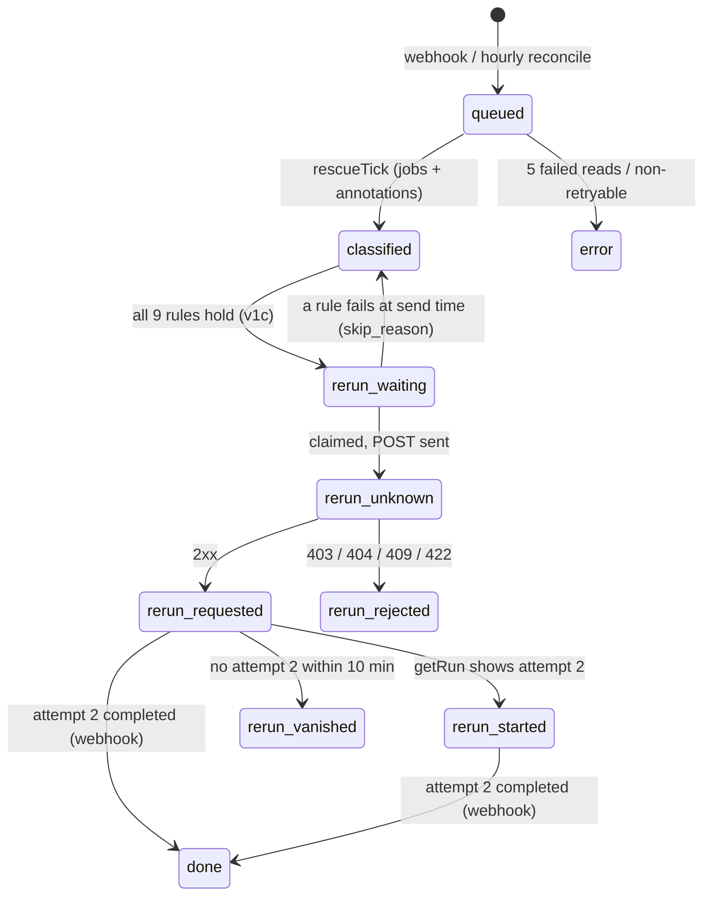

# feat: Cronkick Rescue

## Summary

Notice when GitHub's own infrastructure (not the user's code) broke a GitHub Actions run, report it on a dashboard page and in a weekly email, and, behind three flags, re-run the failed jobs once. v1a (report only) is implemented; this plan finishes v1b (Checks: read) and v1c (re-run once), then verifies, reviews and ships all three.

---

## Problem Frame

GitHub Actions sometimes never gives a job a runner, or a GitHub service fails during setup. Users see a red run and assume their code broke. Cronkick already fires these runs, so it can tell them it was GitHub's fault and, for runs it started, safely retry once.

---

## Requirements

- R1. Queue every failed, startup-failed or cancelled run (not forks) from the `workflow_run` webhook without calling GitHub; reconcile hourly for lost webhooks.
- R2. Classify each run with a pure function using job metadata and, when allowed, GitHub's annotations; store only the matched GitHub string.
- R3. Weekly digest for every plan, once per installation per ISO week; never say "GitHub broke" except for no-runner and setup-service errors.
- R4. Rescue page, overview tile, Settings card, docs and trust pages describe exactly what is read and stored.
- R5. v1b: request Checks: read in app setup, track `installations.checks_read` from install webhooks and the daily reconcile, and show approval state in Settings.
- R6. v1c: re-run failed jobs once, only when all nine eligibility rules hold; claim before the POST, never re-send, never a second re-run per run.
- R7. Ship without disturbing the parallel receipts/recipes session sharing the main checkout.

---

## Scope Boundaries

- No cancel calls, log downloads, LLM classification, flaky-test detection, Slack, new plans, new dependencies or feature-flag service.
- No re-runs of runs Cronkick didn't fire, self-hosted runs, forks, attempts ≥ 2 or metadata-only evidence.
- No `workflow_job` subscription.
- The GitHub App's live permission change and the changelog post are Devesh's, after deploy.

### Deferred to Follow-Up Work

- R4 setup-step service errors as re-run candidates (rule 5 allows only no-runner until reviewed).
- Re-runs for runs Cronkick didn't start (possible Team v2 after shadow data).

---

## Key Technical Decisions

- **Separate worktree, migration 012.** The main checkout holds another session's uncommitted receipts work with `011_receipts.sql`. Rescue lives on `feat/rescue` in its own worktree and takes `012_rescue.sql`; the runner applies unapplied migrations in name order, so either landing order works. Edits to files the other session also touches (`src/sync.ts`, `web/lib/data.ts`, `web/components/history-table.tsx`, security and privacy pages) are kept small and away from their hunks.
- **Claim-then-act for the re-run POST.** The row moves to `rerun_unknown` with `rerun_at` set *before* the POST. A 2xx moves it to `rerun_requested`, 403/404/409/422 to `rerun_rejected`, and no answer or a 5xx leaves it `rerun_unknown`. A crash mid-POST therefore can never re-send, and rule 4 (no earlier Rescue action on this run id) blocks any second attempt.
- **Global switch on Deps.** `RESCUE_RERUN=on` is read in `loadConfig` and passed through `Deps` as an optional flag (default off), so tests can flip it and production stays off until Devesh sets it.
- **GitHub status check through the GitHub interface.** githubstatus.com's unresolved-incidents read is one more method on the interface, so the fake controls it; a failed read counts as "no incident".
- **Blockers computed in `checkWorkflow`.** It already parses the YAML. `rescue_blockers` is written by a separate statement in sync, away from the other session's INSERT change.
- **Eligibility is one function returning the first failing rule's reason.** It is pure over a gathered context (installation, workflow, row, jobs, slot timing, breaker counts), so each rule can be tested by flipping only that input.

---

## High-Level Technical Design

`rerun_waiting` waits until 5 minutes after completion, and longer while githubstatus.com lists an unresolved Actions incident. It never waits past the next slot's due time.

---

## Implementation Units

### U1. v1a: shadow mode and digest (implemented, pending verification)

**Goal:** Verify the existing v1a code against R1–R4.
**Requirements:** R1, R2, R3, R4
**Dependencies:** none
**Files:** `migrations/012_rescue.sql`, `src/rescue.ts`, `src/github.ts`, `src/webhooks.ts`, `src/alerts.ts`, `src/maintenance.ts`, `src/main.ts`, `src/plans.ts`, `test/fakes.ts`, `web/lib/data.ts`, `web/app/dashboard/[installationId]/rescue/page.tsx`, `web/app/dashboard/[installationId]/page.tsx`, `web/app/dashboard/[installationId]/settings/{page.tsx,actions.ts}`, `web/app/docs/rescue/page.tsx`, docs and trust pages, test: `test/rescue.test.ts`
**Approach:** No new behavior; fix whatever verification finds.
**Test scenarios:** as already written in `test/rescue.test.ts` (one per classifier class, webhook queueing and dedupe, tick lease, concurrency, backoff, annotation gating, rate-limit release, digest once per week across two servers, Free upsell, Not-counted line, claim release on failed send, slot alert wording in one email).
**Verification:** worker and web typecheck pass; the full suite passes on an isolated test database.

### U2. v1b: Checks: read

**Goal:** Track whether each installation granted Checks: read, and ask for it in new setups.
**Requirements:** R5
**Dependencies:** U1
**Files:** `scripts/create-github-app.ts`, `README.md`, `deploy/README.md`, `src/github.ts` (`listInstallations` returns checks permission), `src/sync.ts` (`upsertInstallation` sets `checks_read`), `src/webhooks.ts`, `web/app/dashboard/[installationId]/settings/page.tsx`, `web/lib/data.ts`, tests: `test/sync.test.ts` or `test/rescue.test.ts`
**Approach:** First call the annotations endpoint with a dev installation token. If it already works without Checks: read, record that and skip the permission change. Otherwise, `installation` `created` and `new_permissions_accepted` set `checks_read` from `installation.permissions.checks`, and the daily reconcile refreshes it from `GET /app/installations`. Settings shows "Checks: read approved ✓", or a link to the installation's GitHub settings page with the one-line reason.
**Test scenarios:**
- `created` payload with `permissions.checks: 'read'` sets `checks_read` true; one without it leaves it false.
- `new_permissions_accepted` with checks flips false → true.
- Daily reconcile with an installation listed without checks sets it false (permission revoked).
**Verification:** tests pass; Settings renders both states.

### U3. v1c: workflow blockers

**Goal:** Compute `rescue_blockers` per workflow.
**Requirements:** R6 (rule 2)
**Dependencies:** U1
**Files:** `src/compat.ts`, `src/sync.ts`, test: `test/compat.test.ts`
**Approach:** `checkWorkflow` returns blocker messages for any job with `environment:`, any job-level `uses:`, and `pull_request_target` under `on:`. An invalid YAML file is itself a blocker. Sync stores them with a separate UPDATE.
**Test scenarios:** each blocker on its own; a clean workflow gives `[]`; invalid YAML gives one blocker; markers-free workflows still get blockers computed.
**Verification:** compat tests pass; sync writes the column.

### U4. v1c: rerun client, eligibility and sender

**Goal:** Re-run once, safely.
**Requirements:** R6
**Dependencies:** U1, U3
**Files:** `src/github.ts` (`rerunFailedJobs`, `actionsIncident`), `src/config.ts`, `src/deps.ts`, `src/main.ts`, `src/rescue.ts`, `test/fakes.ts`, test: `test/rescue.test.ts`
**Approach:**
- `rerunFailedJobs` mirrors `dispatch()`: 10 s timeout, no retries, `RerunTimeout` on no answer.
- After classification, eligibility runs rules 1–9 and records the first failure as `skip_reason`. An eligible row goes to `rerun_waiting`.
- A sender pass claims due `rerun_waiting` rows with a lease and re-checks rules 1–8 plus `getRun` (completed, attempt still 1). It then claims the send and POSTs once.
- A follow-up pass moves `rerun_requested` rows to `rerun_started` or `rerun_vanished`.
- The breakers allow at most 10 re-runs per installation per day and 100 platform-wide per hour. When the platform breaker trips, Rescue pauses re-runs and reports to Sentry.
**Test scenarios:**
- Each of the 9 rules flipped alone sets its `skip_reason` and sends no POST.
- Dependents guard: a gate job that started after the cancelled matrix leg and ran a step blocks the re-run.
- POST timeout → `rerun_unknown`, and further ticks record exactly one POST ever.
- 403 → `rerun_rejected` with GitHub's message.
- `getRun` still at attempt 1 after 10 minutes → `rerun_vanished`; at attempt 2 → `rerun_started`.
- 11th re-run in a day for one installation is skipped by the breaker.
- `RESCUE_RERUN` unset → zero POSTs even with everything else eligible.
- An unresolved Actions incident keeps the row waiting, but not past the next slot's due time.
**Verification:** rescue tests pass; with the flag off nothing is ever POSTed.

### U5. v1c: email, Settings and history

**Goal:** Tell paid users what Rescue did and let them opt in.
**Requirements:** R6, R4
**Dependencies:** U4
**Files:** `src/alerts.ts`, `src/main.ts`, `web/app/dashboard/[installationId]/settings/{page.tsx,actions.ts}`, `web/lib/data.ts`, `web/app/dashboard/[installationId]/rescue/page.tsx`, `web/components/history-table.tsx`, `web/app/docs/rescue/page.tsx`, test: `test/rescue.test.ts`
**Approach:**
- Re-run email (paid accounts, alert email set, once per row via `rescue:<id>`): sent when attempt 2 finishes, or as "pending" an hour after the re-run.
- Settings mode radio gains "Re-run once", which only paid plans may set; the action re-checks the plan.
- A per-workflow toggle sits next to the exact spec text. It is disabled with the blocker reasons shown when a workflow has blockers, and the action re-checks blockers and ownership.
- The Rescue page shows re-run outcomes, and the history table shows a small badge on the slot row.
**Test scenarios:**
- Email is sent once with the attempt-2 result.
- "Pending" is sent after an hour.
- Free and no-alert-email installations get nothing.
- A failed send releases the claim.
**Verification:** tests and web typecheck pass.

### U6. Verify, review, ship

**Goal:** Land all of it on main without touching the parallel session.
**Requirements:** R7
**Dependencies:** U1–U5
**Files:** none new
**Approach:**
- Run the worker and web typechecks, then the suite against a dedicated test database. The default `cronkick_test` is dropped and recreated by every test file, and the other session may use it.
- Run `/ponytail-review` (the commit hook requires it), and `/ponytail-audit` if it's due. Fix findings.
- Commit on `feat/rescue` and fast-forward `origin/main` from the worktree; CI runs tests, migrates and rolls out one server at a time.
- Watch the deploy to green.
**Verification:** CI green through "Check cronkick.xyz"; `012_rescue.sql` listed in the migrate step summary; the main checkout's working tree untouched.

---

## Risks & Dependencies

| Risk | Mitigation |
|---|---|
| The other session's later push conflicts in shared files | Small, separate hunks; tell Devesh which files to expect on rebase |
| A re-run of a non-idempotent job | Three opt-ins (env, account mode, per-workflow toggle), plus blockers, the dependents guard and attempt 1 only |
| Double POST across two servers | Lease plus the claim-before-POST state change guarded by `state = 'rerun_waiting'` |
| Free digest and compare table promise re-runs before `RESCUE_RERUN` is on | Flagged to Devesh; the copy is true once the env var is set |

---

## Operational Notes

- After deploy: Devesh adds Checks: read to the live app (GitHub emails every owner to approve), writes the changelog post, and sets `RESCUE_RERUN=on` only when ready.
